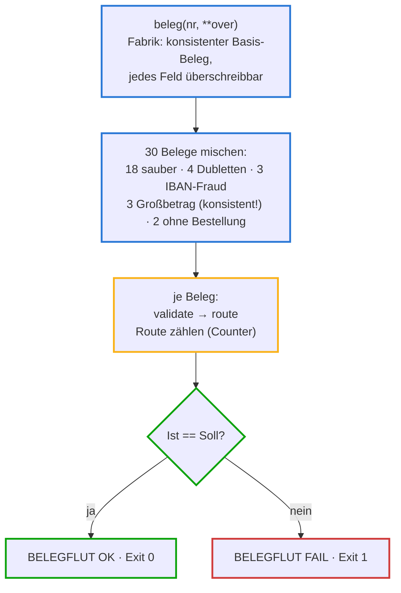

# belegflut.py — das Abnahme-Szenario

**Zweck in einem Satz:** Konstruiert 30 Belege mit **vorher bekannter
Soll-Verteilung** (18 AUTO_POST, 4 REJECT, 8 REVIEW), schickt sie durch
Validierung + Routing und vergleicht Ist gegen Soll — Exit-Code 0 nur bei
exakter Übereinstimmung.

**Einordnung:** Kein Pipeline-Baustein, sondern ein **Szenario-Test** (siehe
Test-Checkliste): Er prüft das Zusammenspiel der Regeln in der Masse, nicht
einzelne Regeln (das tun die Unit-Tests). Gebaut als Szenario-Abnahme des
Testfundaments; bleibt als wiederholbares Werkzeug im Repo.

## Eingaben und Ausgaben

| Was | Details |
|---|---|
| Eingabe | keine Dateien — die 30 Belege entstehen im Skript (konstruiert, je Gruppe mit genau einer bekannten Auffälligkeit); Stammdaten wie im echten Lauf |
| Ausgabe | 30 Ergebniszeilen (Beleg, Route, Risk, ALLE Gründe) + Soll/Ist-Vergleich · Exit 0 = bestanden, Exit 1 = Abweichung |

## Ablauf



Farben unten: **Blau** = Aufbau und Beleg-Konstruktion · **Gelb** = der Lauf ·
**Grün** = Vergleich und Exit · **Rot** = der Fehlerpfad.

## Variablen und Rahmenkriterien

| Element | Wert | Warum so |
|---|---|---|
| Soll-Verteilung | 18 / 4 / 8 | ergibt sich aus der Konstruktion — der Test weiß VORHER, was herauskommen muss; jede Abweichung ist ein Regelversagen |
| Großbetrags-Belege | in sich konsistent + durch PO-4750 gedeckt | Lektion aus einem Abnahme-Lauf: Testdaten müssen die Geschichte erzählen, die sie behaupten — die erste Fassung testete versehentlich V03 mit |
| `TODAY` | 2026-07-28 | derselbe fixierte Stichtag wie in run.py und den Tests |

## Der vollständige Code — geführt

<div class="code-row" markdown="1">
<div class="code-col" markdown="1">
<div class="codeblock-label" data-tone="blau">Aufbau · uv-Metadaten, Docstring mit Soll, Importe über sys.path (Z. 1–32)</div>

```python
# /// script
# requires-python = ">=3.11"
# dependencies = ["pydantic>=2", "python-stdnum"]
# ///
"""Szenario 'Belegflut' (Szenario-Abnahme): 30 konstruierte Belege mit bekannter
Soll-Verteilung laufen durch Validierung + Routing.

Soll: 18x AUTO_POST · 4x REJECT (Dubletten) · 8x REVIEW
      (3 IBAN-Fraud, 3 Grossbetrag [in sich konsistent, PO-4750 gedeckt —
      es feuert NUR die Betragsschwelle], 2 ohne Bestellbezug)
Exit-Codes: 0 = Ist entspricht Soll · 1 = Abweichung.
Aufruf:  uv run scripts/belegflut.py
"""

import sys
from collections import Counter
from datetime import date
from decimal import Decimal
from pathlib import Path

REPO = Path(__file__).resolve().parents[1]
sys.path.insert(0, str(REPO / "poc" / "02-invoice-pipeline"))

from pipeline.models import Invoice, LineItem, Party, Route, SourceFormat, TaxBreakdown
from pipeline.routing import Router
from pipeline.validation import validate

TODAY = date(2026, 7, 28)
MASTER = REPO / "poc" / "02-invoice-pipeline" / "masterdata" / "vendors.json"
VALID_IBAN = "DE89370400440532013000"
ANDERE_IBAN = "DE02120300000000202051"
VALID_VAT = "DE136695976"
```
</div>
<aside class="code-notes" markdown="1">

- **`# /// script … ///`:** Inline-Metadaten (PEP 723) — `uv run` liest
  daraus die Abhängigkeiten und baut sich seine Umgebung selbst. Deshalb
  läuft das Skript ohne Installation mit einem Befehl.
- **Der Docstring trägt das Soll:** wer das Skript öffnet, weiß sofort, was
  ein bestandener Lauf bedeutet — Testabsicht als Dokumentation.
- **`sys.path.insert`:** das Pipeline-Paket ist nicht installiert, sondern
  liegt im POC-Ordner — derselbe pragmatische Kniff wie in
  `tests/conftest.py`.
- **`ANDERE_IBAN` ist eine GÜLTIGE IBAN** — nur eben nicht die hinterlegte.
  So testet der Fraud-Fall wirklich den Stammdaten-Abgleich, nicht die
  V04-Prüfsumme.

</aside>
</div>

<div class="code-row" markdown="1">
<div class="code-col" markdown="1">
<div class="codeblock-label" data-tone="blau">Die Beleg-Fabrik · ein konsistenter Basis-Beleg, alles überschreibbar (Z. 35–48)</div>

```python
def beleg(nr, **over):
    base = dict(
        invoice_number=f"FLUT-{nr:03d}", issue_date=date(2026, 7, 10),
        currency="EUR",
        seller=Party(name="Alpha Buero GmbH", vat_id=VALID_VAT, iban=VALID_IBAN),
        purchase_order_ref="PO-4711",
        lines=[LineItem(description="Ware", quantity=Decimal("1"),
                        unit_price=Decimal("600"), net_amount=Decimal("600.00"))],
        taxes=[TaxBreakdown(rate=Decimal("19"), base=Decimal("600.00"),
                            amount=Decimal("114.00"))],
        total_net=Decimal("600.00"), total_tax=Decimal("114.00"),
        total_gross=Decimal("714.00"), source_format=SourceFormat.UBL,
        source_file=f"flut_{nr:03d}.xml")
    base.update(over)
    return Invoice(**base)
```
</div>
<aside class="code-notes" markdown="1">

- **Das Fabrik-Muster** (wie die `make_invoice`-Fixture der Tests): ein in
  sich stimmiger Basis-Beleg (600 netto + 19 % = 714 brutto, gedeckt durch
  PO-4711), und `**over` überschreibt gezielt einzelne Felder.
- **Warum das mächtig ist:** jede Beleg-Gruppe unten unterscheidet sich vom
  Basis-Beleg in GENAU EINER Eigenschaft — dadurch weiß man bei jeder
  Abweichung sofort, welche Regel sie ausgelöst haben muss.
- **`f"FLUT-{nr:03d}"`:** Format-Angabe `03d` = dreistellig mit führenden
  Nullen (FLUT-001 …).

</aside>
</div>

<div class="code-row" markdown="1">
<div class="code-col" markdown="1">
<div class="codeblock-label" data-tone="blau">Die Mischung · fünf Gruppen mit bekannter Wirkung (Z. 51–77)</div>

```python
def main():
    belege = [beleg(i) for i in range(1, 19)]                        # 18 sauber
    belege += [beleg(i, invoice_number=f"FLUT-{i-4:03d}")            # 4 Dubletten
               for i in range(19, 23)]
    belege += [beleg(i, seller=Party(name="Alpha Buero GmbH",       # 3 IBAN-Fraud
                                     vat_id=VALID_VAT, iban=ANDERE_IBAN))
               for i in range(23, 26)]
    # 3 Grossbetrag — in sich konsistent (21.000 netto + 19 % USt) und durch
    # PO-4750 (Delta Anlagenbau, Wareneingang gebucht) gedeckt: es feuert
    # ausschliesslich die Betragsschwelle (+20)
    belege += [beleg(i,
                     seller=Party(name="Delta Anlagenbau GmbH",
                                  vat_id="DE111111125",
                                  iban="DE27100777770209299700"),
                     purchase_order_ref="PO-4750",
                     lines=[LineItem(description="Anlage",
                                     quantity=Decimal("1"),
                                     unit_price=Decimal("21000"),
                                     net_amount=Decimal("21000.00"))],
                     taxes=[TaxBreakdown(rate=Decimal("19"),
                                         base=Decimal("21000.00"),
                                         amount=Decimal("3990.00"))],
                     total_net=Decimal("21000.00"),
                     total_tax=Decimal("3990.00"),
                     total_gross=Decimal("24990.00"))
               for i in range(26, 29)]
    belege += [beleg(i, purchase_order_ref=None)                    # 2 ohne PO
               for i in range(29, 31)]
```
</div>
<aside class="code-notes" markdown="1">

- **`invoice_number=f"FLUT-{i-4:03d}"`:** Beleg 19 trägt die Nummer von
  Beleg 15 — so entstehen die 4 Dubletten. Sie funktionieren nur, weil die
  Originale VORHER durch den Router liefen (Reihenfolge!).
- **Der Großbetrags-Block ist der längste — mit Absicht:** hier wird ALLES
  konsistent überschrieben (Lieferant, Bestellung, Positionen, Steuern,
  Summen), damit wirklich nur die Betragsschwelle feuert. Die erste Fassung
  überschrieb nur `total_gross` und testete versehentlich V03 mit — eine
  Abnahme-Frage deckte das auf.
- **`range(1, 19)`** erzeugt 1–18 (das Ende ist exklusiv) — daher die
  scheinbar "krummen" Grenzen.

</aside>
</div>

<div class="code-row" markdown="1">
<div class="code-col" markdown="1">
<div class="codeblock-label" data-tone="gelb">Der Lauf · Validierung + Routing, Routen zählen (Z. 79–88)</div>

```python
    router = Router(MASTER)
    ist = Counter()
    for inv in belege:
        d = router.route(inv, validate(inv, TODAY))
        ist[d.route] += 1
        # ALLE Gründe ausgeben, nicht nur den ersten — sonst bleibt bei
        # Mehrfach-Befunden Information verborgen (Lektion aus der Abnahme)
        print(f"{inv.source_file}  {d.route.value:9}  Risk {d.risk_score:3}  "
              f"{' | '.join(d.reasons)}")
```
</div>
<aside class="code-notes" markdown="1">

- **`Counter()`** (aus `collections`): ein Zähl-Dictionary — `ist[route] += 1`
  funktioniert ohne Initialisierung.
- **Ein Router für alle 30:** wie in `run.py` — nur so trägt das
  Dubletten-Register über den Lauf.
- **`' | '.join(d.reasons)`:** die Zeile entstand aus einem Abnahme-Befund —
  vorher zeigte `d.reasons[0]` nur den ersten Grund und
  verdeckte bei flut_026 den zweiten.
- **`:9` und `:3`:** Feldbreiten — die Spalten stehen untereinander,
  30 Zeilen bleiben überfliegbar.

</aside>
</div>

<div class="code-row" markdown="1">
<div class="code-col" markdown="1">
<div class="codeblock-label" data-tone="gruen">Soll gegen Ist · harte Abnahme mit Exit-Code (Z. 90–101)</div>

```python
    soll = {Route.AUTO_POST: 18, Route.REJECT: 4, Route.REVIEW: 8}
    print(f"\nSoll: {dict((k.value, v) for k, v in soll.items())}")
    print(f"Ist:  {dict((k.value, v) for k, v in ist.items())}")
    if dict(ist) != soll:
        print("BELEGFLUT FAIL")
        sys.exit(1)
    print("BELEGFLUT OK")
    sys.exit(0)


if __name__ == "__main__":
    main()
```
</div>
<aside class="code-notes" markdown="1">

- **`dict(ist) != soll`:** exakter Vergleich der kompletten Verteilung —
  eine einzige verrutschte Route lässt die Abnahme durchfallen. Der
  Mutation-Beweis (Soll auf 17/5/8 verstellt → FAIL) hat gezeigt, dass der
  Vergleich wirklich scharf ist.
- **`sys.exit(1)` vs. `exit(0)`:** der Exit-Code IST das Ergebnis — Skripte
  und CI können den Lauf maschinell auswerten. Und: nie den Exit-Code durch
  Pipes entschärfen (Feedback-Regel).

</aside>
</div>

**Zum Nachschlagen:** Datei `scripts/belegflut.py` · Test-Checkliste:
`docs/test-checkliste.md` (Szenario-Test, Abschluss jeder Stufe).

## Selbsttest

<details><summary>1. Warum weiß dieses Skript VORHER, was herauskommen muss — und warum ist das der Kern der Abnahme?</summary>

Weil jede Beleg-Gruppe konstruiert ist: Der Basis-Beleg ist sauber, jede
Gruppe weicht in genau einer bekannten Eigenschaft ab. Die Soll-Verteilung
folgt also aus den Regeln selbst. Stimmt Ist nicht mit Soll überein, hat
sich eine Regel anders verhalten als verstanden — genau das soll eine
Abnahme aufdecken.
</details>

<details><summary>2. Warum mussten die Großbetrags-Belege einen anderen Lieferanten und eine andere Bestellung bekommen?</summary>

Nur `total_gross` hochzusetzen machte den Beleg in sich inkonsistent (V03
feuerte, +40) und riss den 3-Way-Match (Netto über PO-4711-Bestellwert).
Damit NUR die Betragsschwelle (+20) feuert, muss alles zusammenpassen:
konsistente Summen UND eine deckende Bestellung — die gab es in den
Stammdaten nur bei Delta Anlagenbau (PO-4750, 21.000 netto).
</details>

<details><summary>3. Worin unterscheidet sich dieses Szenario von den 15 Unit-Tests in test_routing.py?</summary>

Die Unit-Tests prüfen jede Regel isoliert (ein Befund, ein erwarteter
Punktwert). Das Szenario prüft die Masse und das Zusammenspiel: Reihenfolge
(Dubletten brauchen ihre Originale), Verteilung, Regelinteraktion. Beide
zusammen ergeben erst das Testfundament — Lücken des einen fängt das andere.
</details>
