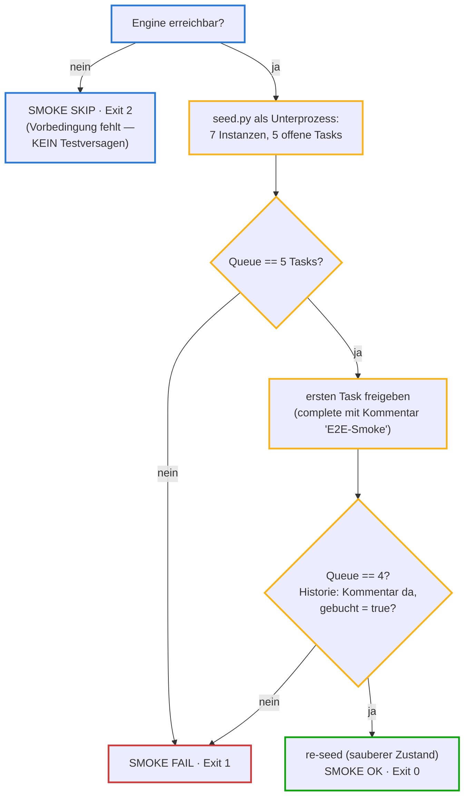

# e2e_smoke.py — der End-to-End-Wächter

**Zweck in einem Satz:** Prüft mit einem einzigen Durchlauf, ob die **ganze
Kette** gesund ist — seeden, Queue prüfen, eine Entscheidung treffen, Historie
kontrollieren, wieder aufräumen — und meldet das Ergebnis als harten Exit-Code.

**Einordnung:** Der "Smoke-Test" (Rauchtest: steigt Rauch auf, brennt es —
ein schneller Grobcheck statt Tiefenprüfung) aus der Test-Checkliste. Er läuft
vor Commits größerer Umbauten und ergänzt die Unit-Tests: die prüfen Logik im
Speicher, der Smoke prüft das Zusammenspiel mit der **echten laufenden
Flowable-Engine** über deren REST-Schnittstelle.

## Eingaben und Ausgaben

| Was | Details |
|---|---|
| Voraussetzung | laufende Flowable-Engine (Docker, Port 8080) — sonst Exit 2 |
| Nutzt | `seed.py` aus POC 06 (als Unterprozess) + die Flowable-REST-API direkt |
| Ausgabe | eine Zeile `SMOKE OK/FAIL/SKIP` + Exit-Code: **0** = Kette gesund · **1** = Verhalten falsch · **2** = Engine nicht erreichbar |

## Ablauf



Farben unten: **Blau** = Aufbau und Vorbedingung · **Gelb** = die Prüfschritte ·
**Grün** = Erfolgspfad · **Rot** = Fehlerpfad.

## Variablen und Rahmenkriterien

| Element | Wert | Warum so |
|---|---|---|
| Drei Exit-Codes | 0 / 1 / 2 | die wichtigste Design-Entscheidung: "Engine aus" (2) ist eine fehlende **Vorbedingung**, kein Testversagen (1) — wer die beiden vermischt, bekommt Fehlalarme oder übersieht echte Brüche |
| Erwartung "5 Tasks" | aus den 7 Demo-Belegen | 2 laufen ohne Menschen durch (AUTO + REJECT), 5 warten — dieselbe Zahl, die das Cockpit als Badge zeigt |
| `timeout=…` an jedem Request | 5–10 s | ein hängender HTTP-Aufruf soll den Wächter nicht einfrieren |

## Der vollständige Code — geführt

<div class="code-row" markdown="1">
<div class="code-col" markdown="1">
<div class="codeblock-label" data-tone="blau">Aufbau · Konstanten und die zwei kleinen Helfer (Z. 1–33)</div>

```python
# /// script
# requires-python = ">=3.11"
# dependencies = ["requests"]
# ///
"""End-to-End-Smoke: seed -> Queue -> eine Entscheidung -> Historie -> re-seed.

Exit-Codes: 0 ok · 1 Verhalten falsch · 2 Engine nicht erreichbar.
Aufruf:  uv run scripts/e2e_smoke.py   (Engine vorher starten, s. Checkliste)
"""

import subprocess
import sys
from pathlib import Path

import requests

REPO = Path(__file__).resolve().parents[1]
APP = REPO / "poc" / "06-cockpit" / "app"
API = "http://localhost:8080/flowable-rest/service"
AUTH = ("rest-admin", "test")
KEY = "rechnungsfreigabe"


def fail(msg):
    print(f"SMOKE FAIL: {msg}")
    sys.exit(1)


def offene_tasks():
    r = requests.get(f"{API}/runtime/tasks", auth=AUTH,
                     params={"processDefinitionKey": KEY, "size": 100}, timeout=10)
    r.raise_for_status()
    return r.json()["data"]
```
</div>
<aside class="code-notes" markdown="1">

- **`fail()` bündelt das Scheitern:** Meldung + Exit 1 an einer Stelle —
  jede Prüfung unten ist dadurch eine Zeile.
- **`offene_tasks()`** fragt die Engine nach offenen Arbeitsschritten des
  Prozesses `rechnungsfreigabe` — dieselbe Abfrage, die der Cockpit-Proxy
  für `/api/queue` nutzt.
- **`raise_for_status()`:** wirft bei HTTP-Fehlern (4xx/5xx) eine Exception,
  statt still mit kaputten Daten weiterzumachen.
- **`AUTH` im Klartext** ist Demo-Scope (bekannte Grenze; geplanter
  Ausbau: Zugangsdaten aus der Umgebung laden).

</aside>
</div>

<div class="code-row" markdown="1">
<div class="code-col" markdown="1">
<div class="codeblock-label" data-tone="blau">Vorbedingung + Seed · Exit 2 ist kein Versagen (Z. 36–46)</div>

```python
def main():
    try:
        requests.get(f"{API}/repository/deployments", auth=AUTH, timeout=5)
    except requests.ConnectionError:
        print("SMOKE SKIP: Engine nicht erreichbar — poc/03-flowable/start_engine.sh")
        sys.exit(2)

    seed = subprocess.run(["uv", "run", "seed.py"], cwd=APP)
    if seed.returncode != 0:
        fail("seed.py fehlgeschlagen")
```
</div>
<aside class="code-notes" markdown="1">

- **Die Exit-2-Weiche zuerst:** ist die Engine aus, ist nichts "kaputt" —
  es fehlt die Vorbedingung. Die Meldung sagt gleich, wie man sie
  herstellt.
- **`subprocess.run([...], cwd=APP)`:** startet `seed.py` als eigenen
  Prozess im Cockpit-Ordner — der Smoke erbt dessen Verhalten, statt es zu
  duplizieren. `returncode` wird geprüft (Exit-Code-Disziplin auch nach
  innen).

</aside>
</div>

<div class="code-row" markdown="1">
<div class="code-col" markdown="1">
<div class="codeblock-label" data-tone="gelb">Queue prüfen + eine echte Entscheidung treffen (Z. 48–62)</div>

```python
    tasks = offene_tasks()
    if len(tasks) != 5:
        fail(f"erwartet 5 offene Tasks nach Seed, gefunden {len(tasks)}")

    task = tasks[0]
    r = requests.post(f"{API}/runtime/tasks/{task['id']}", auth=AUTH, json={
        "action": "complete",
        "variables": [
            {"name": "freigegeben", "type": "boolean", "value": True},
            {"name": "kommentar", "type": "string", "value": "E2E-Smoke"},
            {"name": "entschiedenVon", "type": "string", "value": "smoke"},
        ]}, timeout=10)
    if not r.ok:
        fail(f"Task-Complete antwortet {r.status_code}")

    if len(offene_tasks()) != 4:
        fail("Task ist nach Entscheidung nicht aus der Queue verschwunden")
```
</div>
<aside class="code-notes" markdown="1">

- **`!= 5` ist eine exakte Erwartung**, kein "mindestens": auch ZU VIELE
  Tasks wären ein Regelbruch. Der Mutation-Beweis lief über genau diese
  Zahl (auf 99 verstellt → FAIL).
- **Der POST ist dieselbe Flowable-Operation**, die der Freigeben-Button im
  Cockpit auslöst — nur ohne Browser. `entschiedenVon: "smoke"` markiert
  die Entscheidung als maschinell.
- **Nach der Entscheidung wird die Queue ERNEUT gelesen:** der Test glaubt
  nicht der Antwort des POST, sondern prüft den Effekt.

</aside>
</div>

<div class="code-row" markdown="1">
<div class="code-col" markdown="1">
<div class="codeblock-label" data-tone="gruen">Historie prüfen + aufräumen · der Beweis im Audit-Trail (Z. 64–78)</div>

```python
    hv = requests.get(f"{API}/history/historic-variable-instances", auth=AUTH,
                      params={"processInstanceId": task["processInstanceId"],
                              "size": 50}, timeout=10).json()["data"]
    v = {x["variable"]["name"]: x["variable"]["value"] for x in hv}
    if v.get("kommentar") != "E2E-Smoke" or not v.get("gebucht"):
        fail(f"Historie unvollständig: {v}")

    subprocess.run(["uv", "run", "seed.py"], cwd=APP, check=True)
    print("SMOKE OK: seed -> queue(5) -> complete -> queue(4) -> Historie -> re-seed")
    sys.exit(0)


if __name__ == "__main__":
    main()
```
</div>
<aside class="code-notes" markdown="1">

- **Dict Comprehension** formt die Flowable-Antwort (Liste von
  Variablen-Objekten) in ein einfaches `name → wert`-Dictionary um.
- **Zwei Historie-Prüfungen:** der Kommentar kam an UND `gebucht` wurde vom
  Prozess gesetzt — d. h. der Service-Task "Dunkelbuchung auslösen" ist
  wirklich gelaufen. Das prüft den Prozess HINTER dem Task, nicht nur die
  Task-API.
- **re-seed am Ende:** der Wächter hinterlässt einen sauberen Demo-Zustand
  (`check=True` wirft, falls das schiefgeht). Wer danach das Cockpit
  öffnet, sieht wieder 5 offene Tasks.

</aside>
</div>

**Zum Nachschlagen:** Datei `scripts/e2e_smoke.py` · Gegenstücke:
`poc/06-cockpit/app/seed.py` (bestückt die Demo) und `app/server.py` (nutzt
dieselben Engine-Endpunkte für das Cockpit).

## Selbsttest

<details><summary>1. Warum gibt es drei Exit-Codes statt zwei — was wäre schlimm daran, "Engine aus" als Versagen (1) zu melden?</summary>

Weil dann jeder Lauf ohne gestartete Engine wie ein kaputtes System aussähe:
In einer Automatisierung (z. B. vor Commits) würde man entweder ständig
Fehlalarme bekommen — oder anfangen, Exit 1 zu ignorieren, und damit echte
Brüche übersehen. Exit 2 sagt präzise: "Vorbedingung herstellen, dann noch
mal."
</details>

<details><summary>2. Der Smoke prüft nach dem POST die Queue erneut und liest zusätzlich die Historie. Warum reicht die POST-Antwort nicht?</summary>

Die POST-Antwort bestätigt nur, dass die API den Aufruf angenommen hat —
nicht, dass der Prozess korrekt weiterlief. Queue-Länge (Task weg) und
Historie (`kommentar` angekommen, `gebucht` durch den Folge-Schritt gesetzt)
prüfen den EFFEKT durch die ganze Prozess-Maschine hindurch. Wächter glauben
Effekten, nicht Antworten.
</details>

<details><summary>3. Was unterscheidet diesen Smoke von den 33 pytest-Tests?</summary>

Die pytest-Suite läuft im Speicher gegen die Python-Logik — schnell, ohne
Infrastruktur. Der Smoke braucht die echte Engine und prüft Deployment,
REST-Schnittstelle, DMN-Ausführung und Prozessfluss im Zusammenspiel. Er ist
langsamer und grober, fängt aber die Fehlerklasse "Logik ok, Integration
kaputt", die Unit-Tests strukturell nicht sehen können.
</details>
