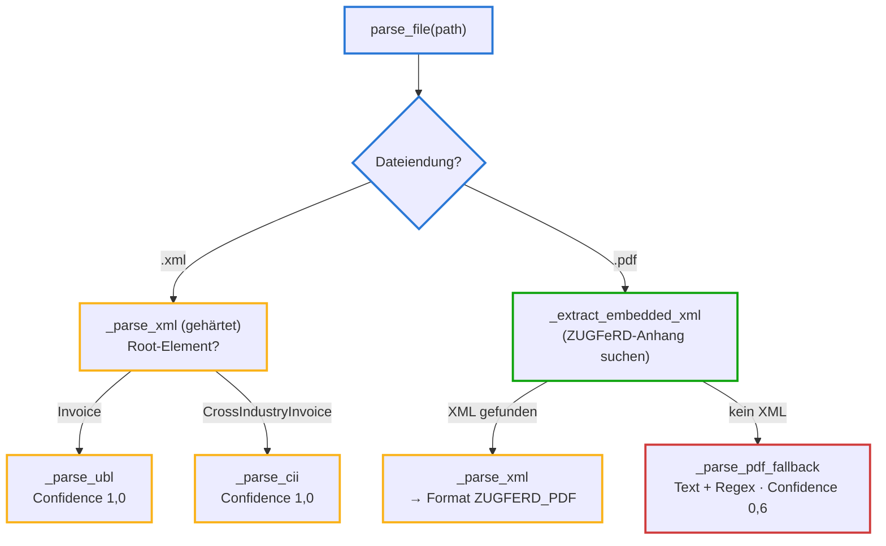

# parsers.py — Format-Erkennung und drei Parser-Wege (Schicht 1)

**Zweck in einem Satz:** Macht aus einer Eingangsdatei (XML oder PDF) ein
einheitliches `Invoice`-Objekt — über den zuverlässigsten verfügbaren Weg:
strukturiertes XML zuerst, eingebettetes ZUGFeRD-XML als zweites, Text-Raten
nur als letzter Ausweg.

**Einordnung in die Kette:** Erste Schicht der Pipeline. Alles Weitere
([validation.py](atlas-validation.md), [routing.py](atlas-routing.md)) arbeitet
nur noch mit dem kanonischen `Invoice`-Modell — die Format-Vielfalt endet hier.

## Eingaben und Ausgaben

| Was | Details |
|---|---|
| Eingabe | Dateipfad: `.xml` (XRechnung UBL oder CII) oder `.pdf` (ZUGFeRD mit eingebettetem XML, sonst Scan/Text) |
| Ausgabe | `Invoice` mit `source_format` (welcher Weg wurde genommen) und `extraction_confidence` (1,0 deterministisch · 0,6 Text-Heuristik) |

## Ablauf



Farben unten im Code: **Blau** = Aufbau und Weiche · **Gelb** = XML-Parser
(UBL/CII) · **Grün** = ZUGFeRD-Extraktion · **Rot** = Text-Fallback (der
unsicherste Weg — deshalb Confidence 0,6, die im Routing nie dunkelbucht).

## Variablen und Rahmenkriterien

| Element | Wert | Warum so |
|---|---|---|
| `_SAFE_XML` | resolve_entities=False, no_network=True, load_dtd=False, huge_tree=False | Eingangsrechnungen sind Fremddaten: kein Entity-Auflösen (XXE), kein Netz, keine Entity-Bomben ("Billion Laughs"). Als Regressionstest verankert |
| `NS_UBL` / `NS_CII` | XML-Namespace-Tabellen | XRechnung nutzt lange Namespace-URIs; die Kürzel (cbc, cac, ram …) machen die XPath-Ausdrücke lesbar |
| `XML_ATTACHMENT_NAMES` | factur-x.xml, zugferd-invoice.xml, xrechnung.xml | die drei üblichen Dateinamen des eingebetteten XML in ZUGFeRD/Factur-X-PDFs |
| `MONEY` | Regex `([\d.]+,\d{2})` | deutsches Betragsformat im Fallback: Punkt als Tausender-, Komma als Dezimaltrenner |
| Confidence | 1,0 / 0,6 | XML-Wege sind deterministisch (1,0); der Text-Fallback ist geraten (0,6 — bewusst unter dem 0,9-Gate des Routings) |

## Prüfungen und Fehlerpfade

- Unbekannte Dateiendung und unbekanntes XML-Root-Element werfen sofort
  `ValueError` — lieber laut scheitern als still falsch parsen.
- Kaputtes/leeres XML wirft in `etree.fromstring` — der adversariale Test
  (`a2`, `a3`) verankert genau das.
- Fehlende Felder werden zu Platzhaltern (`"?"`, `"0"`) statt Abstürzen — die
  Validierung (V06) macht daraus dann saubere Befunde.

## Der vollständige Code — geführt

<div class="code-row" markdown="1">
<div class="code-col" markdown="1">
<div class="codeblock-label" data-tone="blau">Aufbau · Strategie-Docstring, Importe, Namespace-Tabellen (Z. 1–32)</div>

```python
"""Format-Erkennung und Parser: UBL-XML, CII-XML, ZUGFeRD-PDF, PDF-Fallback.

Strategie (Reihenfolge = Zuverlässigkeit):
  1. XML (XRechnung): UBL oder CII — deterministisch, confidence 1.0
  2. PDF mit eingebettetem XML (ZUGFeRD/Factur-X): XML extrahieren -> wie 1.
  3. PDF ohne XML: Text-Extraktion + Regex-Heuristik, confidence 0.6.
     Hier würde produktiv eine LLM-Extraktion (Vision-Modell + Pydantic-Schema,
     z.B. via instructor) andocken — siehe llm_extract_stub().
"""

import io
import re
from datetime import date, datetime
from decimal import Decimal
from pathlib import Path

import pdfplumber
from lxml import etree
from pypdf import PdfReader

from .models import Invoice, LineItem, Party, SourceFormat, TaxBreakdown

NS_UBL = {
    "inv": "urn:oasis:names:specification:ubl:schema:xsd:Invoice-2",
    "cac": "urn:oasis:names:specification:ubl:schema:xsd:CommonAggregateComponents-2",
    "cbc": "urn:oasis:names:specification:ubl:schema:xsd:CommonBasicComponents-2",
}
NS_CII = {
    "rsm": "urn:un:unece:uncefact:data:standard:CrossIndustryInvoice:100",
    "ram": "urn:un:unece:uncefact:data:standard:ReusableAggregateBusinessInformationEntity:100",
    "udt": "urn:un:unece:uncefact:data:standard:UnqualifiedDataType:100",
}
```
</div>
<aside class="code-notes" markdown="1">

- **Drei Parser-Bibliotheken, drei Aufgaben:** `lxml` liest XML, `pypdf`
  holt Datei-Anhänge aus PDFs, `pdfplumber` extrahiert sichtbaren Text.
- **Namespaces:** XML-Elemente der XRechnung heißen voll qualifiziert z. B.
  `{urn:…:CommonBasicComponents-2}ID` — die Tabellen ordnen den langen URIs
  Kürzel zu, damit XPath-Ausdrücke wie `cbc:ID` lesbar bleiben.
- Die **Strategie im Docstring** ist die Kernaussage der Datei: Reihenfolge
  = Zuverlässigkeit, und der LLM-Andockpunkt ist benannt, nicht versteckt.

</aside>
</div>

<div class="code-row" markdown="1">
<div class="code-col" markdown="1">
<div class="codeblock-label" data-tone="blau">Die Weiche · parse_file entscheidet den Weg (Z. 35–45)</div>

```python
def parse_file(path: Path) -> Invoice:
    if path.suffix.lower() == ".xml":
        return _parse_xml(path.read_bytes(), path.name)
    if path.suffix.lower() == ".pdf":
        embedded = _extract_embedded_xml(path)
        if embedded is not None:
            inv = _parse_xml(embedded, path.name)
            inv.source_format = SourceFormat.ZUGFERD_PDF
            return inv
        return _parse_pdf_fallback(path)
    raise ValueError(f"Nicht unterstütztes Format: {path.name}")
```
</div>
<aside class="code-notes" markdown="1">

- **`suffix.lower()`:** `.XML` und `.xml` gleichbehandeln.
- **ZUGFeRD ist "PDF, aber eigentlich XML":** findet sich ein eingebetteter
  Anhang, läuft derselbe XML-Parser — nur das `source_format` wird danach
  auf ZUGFERD_PDF umgestellt (fürs Reporting).
- **`is not None` statt Truthy-Check:** ein leerer Bytes-Anhang wäre auch
  "falsy" — die explizite Prüfung unterscheidet "kein Anhang" von
  "leerer Anhang".
- Unbekannte Endung → sofortiger `ValueError`, kein stilles Raten.

</aside>
</div>

<div class="code-row" markdown="1">
<div class="code-col" markdown="1">
<div class="codeblock-label" data-tone="gelb">Gehärteter XML-Einstieg + der XPath-Helfer (Z. 48–69)</div>

```python
# --- XML (XRechnung: UBL / CII) -----------------------------------------

# Gehärteter Parser: Eingangsrechnungen sind Fremddaten. Keine Entity-Expansion,
# kein DTD-Load, kein Netzwerkzugriff — schließt XXE und Billion-Laughs aus.
_SAFE_XML = etree.XMLParser(
    resolve_entities=False, no_network=True, load_dtd=False, huge_tree=False
)


def _parse_xml(data: bytes, filename: str) -> Invoice:
    root = etree.fromstring(data, parser=_SAFE_XML)
    tag = etree.QName(root).localname
    if tag == "Invoice":
        return _parse_ubl(root, filename)
    if tag == "CrossIndustryInvoice":
        return _parse_cii(root, filename)
    raise ValueError(f"Unbekanntes XML-Root-Element: {tag}")


def _x(root, xpath: str, ns) -> str | None:
    r = root.xpath(xpath, namespaces=ns)
    return r[0].text.strip() if r and r[0].text else None
```
</div>
<aside class="code-notes" markdown="1">

- **`_SAFE_XML` ist die Sicherheitsentscheidung der Datei:** vier Flags, die
  XXE (externe Entities lesen lokale Dateien) und Entity-Bomben abschalten.
  Der Test `test_xxe_entity_wird_nicht_aufgeloest` hält das dauerhaft fest.
- **Format-Erkennung am Root-Element:** UBL-Rechnungen heißen `Invoice`,
  CII-Rechnungen `CrossIndustryInvoice` — ein Blick genügt.
- **`_x` ist der zentrale Lese-Helfer:** XPath ausführen, erstes Ergebnis
  nehmen, Text trimmen, sonst `None`. Dass ALLE Feldzugriffe durch diese eine
  Funktion laufen, hält die beiden großen Parser darunter kompakt.

</aside>
</div>

<div class="code-row" markdown="1">
<div class="code-col" markdown="1">
<div class="codeblock-label" data-tone="gelb">UBL-Parser · XRechnung in der UBL-Syntax (Z. 72–105)</div>

```python
def _parse_ubl(root, filename: str) -> Invoice:
    ns = NS_UBL
    lines = []
    for il in root.xpath("//cac:InvoiceLine", namespaces=ns):
        lines.append(LineItem(
            description=_x(il, ".//cac:Item/cbc:Name", ns) or "?",
            quantity=Decimal(_x(il, "./cbc:InvoicedQuantity", ns) or "0"),
            unit_price=Decimal(_x(il, ".//cac:Price/cbc:PriceAmount", ns) or "0"),
            net_amount=Decimal(_x(il, "./cbc:LineExtensionAmount", ns) or "0"),
        ))
    taxes = []
    for ts in root.xpath("//cac:TaxTotal/cac:TaxSubtotal", namespaces=ns):
        taxes.append(TaxBreakdown(
            rate=Decimal(_x(ts, ".//cac:TaxCategory/cbc:Percent", ns) or "0"),
            base=Decimal(_x(ts, "./cbc:TaxableAmount", ns) or "0"),
            amount=Decimal(_x(ts, "./cbc:TaxAmount", ns) or "0"),
        ))
    return Invoice(
        invoice_number=_x(root, "/inv:Invoice/cbc:ID", ns) or "?",
        issue_date=date.fromisoformat(_x(root, "/inv:Invoice/cbc:IssueDate", ns)),
        currency=_x(root, "/inv:Invoice/cbc:DocumentCurrencyCode", ns) or "EUR",
        seller=Party(
            name=_x(root, "//cac:AccountingSupplierParty//cac:PartyLegalEntity/cbc:RegistrationName", ns) or "?",
            vat_id=_x(root, "//cac:AccountingSupplierParty//cac:PartyTaxScheme/cbc:CompanyID", ns),
            iban=_x(root, "//cac:PaymentMeans//cac:PayeeFinancialAccount/cbc:ID", ns),
        ),
        buyer_name=_x(root, "//cac:AccountingCustomerParty//cac:PartyLegalEntity/cbc:RegistrationName", ns),
        purchase_order_ref=_x(root, "//cac:OrderReference/cbc:ID", ns),
        lines=lines, taxes=taxes,
        total_net=Decimal(_x(root, "//cac:LegalMonetaryTotal/cbc:LineExtensionAmount", ns) or "0"),
        total_tax=Decimal(_x(root, "/inv:Invoice/cac:TaxTotal/cbc:TaxAmount", ns) or "0"),
        total_gross=Decimal(_x(root, "//cac:LegalMonetaryTotal/cbc:TaxInclusiveAmount", ns) or "0"),
        source_format=SourceFormat.UBL, source_file=filename,
    )
```
</div>
<aside class="code-notes" markdown="1">

- **Struktur = drei Sammel-Schritte:** Positionen (`InvoiceLine`),
  Steuerblöcke (`TaxSubtotal`), dann das große `Invoice(...)` mit den
  Kopffeldern.
- **`or "?"` / `or "0"`:** fehlende Felder werden zu Platzhaltern statt
  Abstürzen — V06 in der Validierung meldet das dann kontrolliert.
- **`purchase_order_ref` aus `OrderReference/ID`:** das EN-16931-Feld BT-13 —
  der Schlüssel für den 3-Way-Match im Routing.
- **`date.fromisoformat`:** UBL schreibt Daten als `2026-07-01` — direkt
  parsebar. (Vergleiche CII unten: anderes Format, andere Funktion.)

</aside>
</div>

<div class="code-row" markdown="1">
<div class="code-col" markdown="1">
<div class="codeblock-label" data-tone="gelb">CII-Parser · dieselbe Semantik, völlig andere Struktur (Z. 108–142)</div>

```python
def _parse_cii(root, filename: str) -> Invoice:
    ns = NS_CII
    lines = []
    for il in root.xpath("//ram:IncludedSupplyChainTradeLineItem", namespaces=ns):
        lines.append(LineItem(
            description=_x(il, ".//ram:SpecifiedTradeProduct/ram:Name", ns) or "?",
            quantity=Decimal(_x(il, ".//ram:BilledQuantity", ns) or "0"),
            unit_price=Decimal(_x(il, ".//ram:NetPriceProductTradePrice/ram:ChargeAmount", ns) or "0"),
            net_amount=Decimal(_x(il, ".//ram:SpecifiedTradeSettlementLineMonetarySummation/ram:LineTotalAmount", ns) or "0"),
        ))
    taxes = []
    for tt in root.xpath("//ram:ApplicableHeaderTradeSettlement/ram:ApplicableTradeTax", namespaces=ns):
        taxes.append(TaxBreakdown(
            rate=Decimal(_x(tt, "./ram:RateApplicablePercent", ns) or "0"),
            base=Decimal(_x(tt, "./ram:BasisAmount", ns) or "0"),
            amount=Decimal(_x(tt, "./ram:CalculatedAmount", ns) or "0"),
        ))
    ds = _x(root, "//rsm:ExchangedDocument/ram:IssueDateTime/udt:DateTimeString", ns)
    return Invoice(
        invoice_number=_x(root, "//rsm:ExchangedDocument/ram:ID", ns) or "?",
        issue_date=datetime.strptime(ds, "%Y%m%d").date(),
        currency=_x(root, "//ram:InvoiceCurrencyCode", ns) or "EUR",
        seller=Party(
            name=_x(root, "//ram:SellerTradeParty/ram:Name", ns) or "?",
            vat_id=_x(root, "//ram:SellerTradeParty/ram:SpecifiedTaxRegistration/ram:ID", ns),
            iban=_x(root, "//ram:PayeePartyCreditorFinancialAccount/ram:IBANID", ns),
        ),
        buyer_name=_x(root, "//ram:BuyerTradeParty/ram:Name", ns),
        purchase_order_ref=_x(root, "//ram:BuyerOrderReferencedDocument/ram:IssuerAssignedID", ns),
        lines=lines, taxes=taxes,
        total_net=Decimal(_x(root, "//ram:SpecifiedTradeSettlementHeaderMonetarySummation/ram:LineTotalAmount", ns) or "0"),
        total_tax=Decimal(_x(root, "//ram:SpecifiedTradeSettlementHeaderMonetarySummation/ram:TaxTotalAmount", ns) or "0"),
        total_gross=Decimal(_x(root, "//ram:SpecifiedTradeSettlementHeaderMonetarySummation/ram:GrandTotalAmount", ns) or "0"),
        source_format=SourceFormat.CII, source_file=filename,
    )
```
</div>
<aside class="code-notes" markdown="1">

- **Der Seite-an-Seite-Beweis für "gleiche Semantik, andere Syntax":**
  identischer Aufbau wie der UBL-Parser, aber jede Pfad-Zeile ist anders —
  die Positionszeile heißt hier `IncludedSupplyChainTradeLineItem` statt
  `InvoiceLine`.
- **`strptime(ds, "%Y%m%d")`:** CII schreibt Daten als `20260701` —
  deshalb ein anderer Datums-Parser als bei UBL. Genau solche Details
  machen den Unterschied zwischen "beide Formate unterstützt" und
  "kompiliert, aber crasht".
- Das Ergebnis ist trotzdem **dasselbe `Invoice`-Modell** — ab hier ist der
  Pipeline egal, welche Syntax der Beleg hatte.

</aside>
</div>

<div class="code-row" markdown="1">
<div class="code-col" markdown="1">
<div class="codeblock-label" data-tone="gruen">ZUGFeRD · das XML aus dem PDF holen (Z. 145–155)</div>

```python
# --- ZUGFeRD: eingebettetes XML aus PDF/A-3 ------------------------------

XML_ATTACHMENT_NAMES = {"factur-x.xml", "zugferd-invoice.xml", "xrechnung.xml"}


def _extract_embedded_xml(path: Path) -> bytes | None:
    reader = PdfReader(str(path))
    for name, content_list in reader.attachments.items():
        if name.lower() in XML_ATTACHMENT_NAMES:
            return content_list[0]
    return None
```
</div>
<aside class="code-notes" markdown="1">

- **PDF/A-3 erlaubt Datei-Anhänge** — ZUGFeRD nutzt das: ein PDF fürs Auge,
  darin ein XML für die Maschine. `pypdf` listet die Anhänge auf.
- **Set-Lookup über bekannte Dateinamen:** die drei Namen decken
  ZUGFeRD-Versionen und den französischen Zwilling Factur-X ab.
- **`None` als bewusste Antwort:** "kein XML gefunden" ist kein Fehler,
  sondern die Weiche zum Fallback-Pfad.

</aside>
</div>

<div class="code-row" markdown="1">
<div class="code-col" markdown="1">
<div class="codeblock-label" data-tone="rot">Text-Fallback · Regex-Heuristik mit Confidence 0,6 (Z. 158–194)</div>

```python
# --- PDF-Fallback: Text + Regex (produktiv: LLM-Extraktion) ---------------

MONEY = r"([\d.]+,\d{2})"


def _dec(s: str) -> Decimal:
    return Decimal(s.replace(".", "").replace(",", "."))


def _parse_pdf_fallback(path: Path) -> Invoice:
    with pdfplumber.open(str(path)) as pdf:
        text = "\n".join(p.extract_text() or "" for p in pdf.pages)

    def find(pattern, default=None):
        m = re.search(pattern, text, re.IGNORECASE)
        return m.group(1) if m else default

    num = find(r"Rechnung(?:s-?Nr\.?|snummer)[:\s]+(\S+)", "?")
    d = find(r"Datum[:\s]+(\d{2}\.\d{2}\.\d{4})")
    net = find(rf"Netto(?:betrag)?[:\s]+{MONEY}")
    tax = find(rf"(?:USt|MwSt)\.?\s*(?:19|7)?\s*%?[:\s]+{MONEY}")
    gross = find(rf"(?:Brutto|Gesamt)(?:betrag)?[:\s]+{MONEY}")
    seller = find(r"^(.+?)\n", "Unbekannt")
    iban = find(r"IBAN[:\s]+([A-Z]{2}\d[\dA-Z ]{12,32})")

    return Invoice(
        invoice_number=num,
        issue_date=datetime.strptime(d, "%d.%m.%Y").date() if d else date(1900, 1, 1),
        seller=Party(name=seller.strip(), vat_id=find(r"(DE\d{9})"),
                     iban=iban.replace(" ", "") if iban else None),
        total_net=_dec(net) if net else Decimal(0),
        total_tax=_dec(tax) if tax else Decimal(0),
        total_gross=_dec(gross) if gross else Decimal(0),
        source_format=SourceFormat.PDF_FALLBACK,
        extraction_confidence=0.6,
        source_file=path.name,
    )
```
</div>
<aside class="code-notes" markdown="1">

- **`_dec("1.428,00") → 1428.00`:** deutsches Zahlenformat umdrehen —
  Tausenderpunkt raus, Komma wird Dezimalpunkt. (Der umgekehrte Weg — englische
  Decimal-Ausgabe in deutschen Begründungstexten — ist eine bekannte offene
  Kleinigkeit der Kette.)
- **`(?:…)`:** nicht-fangende Gruppen — matchen Varianten
  ("Rechnungs-Nr.", "Rechnungsnummer"), ohne das Ergebnis zu verschieben.
- **`extraction_confidence=0.6` ist die wichtigste Zeile:** dieser Pfad rät.
  Die 0,6 liegt bewusst unter dem 0,9-Gate des Routings — ein geratener
  Beleg landet IMMER bei einem Menschen (Szenario s6).
- **`date(1900, 1, 1)` als Notnagel:** fehlt das Datum, fällt der Beleg in
  V07 ("älter als 1 Jahr") auf — der Platzhalter ist absichtlich auffällig.

</aside>
</div>

<div class="code-row" markdown="1">
<div class="code-col" markdown="1">
<div class="codeblock-label" data-tone="blau">Der benannte Andockpunkt · llm_extract_stub (Z. 197–211)</div>

```python
def llm_extract_stub(path: Path) -> None:
    """Andockpunkt für produktive LLM-Extraktion unstrukturierter Belege.

    Muster (siehe Research-Note): Vision-LLM (z.B. Claude) erhält das Belegbild
    plus das Pydantic-JSON-Schema von `Invoice` und liefert validierte Felder;
    Bibliothek `instructor` erzwingt Schema-Konformität mit Retry.

    Ehrlichkeits-Hinweis: Im POC ist extraction_confidence eine gesetzte
    Konstante (0.6 Text-Heuristik, 0.85 LLM-Demo) — bewusst so gewählt, dass
    beide Pfade unter dem Routing-Schwellwert 0.9 bleiben und nie dunkel
    gebucht werden. Produktiv würde der Wert aus Modell-Logprobs bzw.
    Feld-Heuristiken abgeleitet.
    """
    raise NotImplementedError
```
</div>
<aside class="code-notes" markdown="1">

- **Ein Stub als Dokumentation:** die Funktion tut nichts
  (`NotImplementedError`), aber sie *benennt* den produktiven Ausbau und
  trägt den Ehrlichkeits-Hinweis zu den Confidence-Konstanten — derselbe
  ehrliche Umgang wie in der übrigen Projekt-Doku.
- POC 05 (`llm_extract.py`) ist die lauffähige Demo genau dieses Musters:
  Claude extrahiert, dieselben Regeln validieren, Confidence 0,85 bleibt
  unter dem Gate.

</aside>
</div>

**Zum Nachschlagen:** Datei `poc/02-invoice-pipeline/pipeline/parsers.py` ·
Tests: `tests/test_adversarial.py` (XXE, kaputtes XML, leere Datei).

## Selbsttest

<details><summary>1. Warum ist die Reihenfolge XML → ZUGFeRD → Text-Fallback mehr als eine Geschmacksfrage?</summary>

Reihenfolge = Zuverlässigkeit = Confidence: strukturierte Wege sind
deterministisch (1,0), der Text-Weg rät (0,6). Wer zuerst den unsichersten
Weg probieren würde, verlöre Präzision, obwohl bessere Daten in der Datei
stecken. Und die Confidence entscheidet später mit, ob ein Mensch draufschaut.
</details>

<details><summary>2. Was genau verhindert der _SAFE_XML-Parser, und wie ist das abgesichert?</summary>

XXE (eine externe Entity liest z. B. lokale Dateien und schleust den Inhalt
in Felder ein) und Entity-Expansions-Bomben. Vier lxml-Flags schalten das ab.
Abgesichert durch den adversarialen Testbeleg `a1_xxe.xml`, der als
Regressionstest im Repo liegt — der Fix kann nicht unbemerkt zurückrollen.
</details>

<details><summary>3. Warum haben UBL und CII zwei getrennte Parser, obwohl beide "XRechnung" sind?</summary>

Gleiche Norm-Semantik (EN 16931), aber völlig andere XML-Strukturen und
sogar Datumsformate (ISO `2026-07-01` vs. kompakt `20260701`). Gemeinsam ist
ihnen das Ziel-Modell `Invoice` — die Format-Vielfalt endet an dieser Schicht.
</details>
