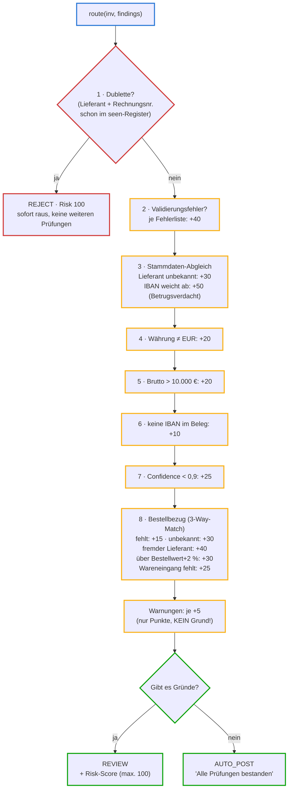

# routing.py — das risikogestaffelte Routing (Schicht 3 der Pipeline)

**Zweck in einem Satz:** Entscheidet für jede validierte Rechnung, ob sie ohne
Menschen gebucht werden darf (AUTO_POST), geprüft werden muss (REVIEW) oder
abgewiesen wird (REJECT) — und vergibt dazu eine Risikopunktzahl (0–100), die
später in der DMN-Tabelle (Decision Model and Notation: ausführbare
Entscheidungstabelle) die Freigabestufe steuert.

**Einordnung in die Kette:** Läuft als dritte Schicht nach dem Parsen
(`parsers.py`) und der Validierung (`validation.py`). Sein Ergebnis
(`RoutingDecision`) landet in `results.json` — genau dem Format, das Flowable
(POC 03) und das Cockpit (POC 06) konsumieren.

## Eingaben

| Eingabe | Woher | Was drinsteckt |
|---|---|---|
| `Invoice`-Objekt | `parsers.py` | die geparste Rechnung: Beträge, Lieferant (Name, USt-ID, IBAN), Bestellreferenz, Extraktions-Confidence (Vertrauenswert 0–1 der Felderkennung) |
| `findings`-Liste | `validation.py` | Prüfbefunde V01–V08, je mit Schweregrad error/warning |
| `vendors.json` | Stammdaten-Ordner | bekannte Lieferanten: USt-ID → Name + hinterlegte IBAN |
| `purchase_orders.json` | Stammdaten-Ordner | Bestellungen: Nummer → Lieferant, Netto-Bestellwert, Wareneingang ja/nein |

## Ablauf

Der Router prüft acht Regelblöcke **in fester Reihenfolge**. Jeder Treffer
erzeugt einen Grund (Klartext) und Risikopunkte. Entscheidend:

> **Die Route hängt an den Gründen, nicht an den Punkten.** Ein einziger Grund
> erzwingt REVIEW; die Punkte sagen nur, *wie kritisch* — und steuern später
> die Eskalation (ab 50 → Teamleitung).



Die Randfarben der Blöcke tauchen unten im Code wieder auf:
**Blau** = Aufbau/Einstieg · **Rot** = Abbruchregel (Dublette) ·
**Gelb** = Punkteregeln 2–8 · **Grün** = Routenentscheid.

## Variablen und Rahmenkriterien

| Konstante | Wert | Warum so |
|---|---|---|
| `AUTO_POST_LIMIT` | 10.000 € | Dunkelbuchungsgrenze: darüber immer menschliche Freigabe. Steht aktuell doppelt (hier UND in der DMN) — bekannte Schwäche; geplanter Ausbau: Schwelle nur noch in der DMN als Single Source of Truth |
| `MIN_CONFIDENCE` | 0,9 | Felderkennungen unter 90 % Vertrauen (Text-Heuristik 0,6 / LLM 0,85) dürfen nie dunkelbuchen |
| `PO_TOLERANZ` | 0,02 (2 %) | Rechnung darf den Bestellwert um max. 2 % übersteigen (Rundungen, Frachtkosten) — mehr ist Klärfall |
| `self.seen` | Set im Arbeitsspeicher | Dubletten-Register über (USt-ID, Rechnungsnummer). In-memory = pro Lauf; produktiv: Idempotenz-Schlüssel in einer Datenbank (geplanter Ausbau) |
| Risk-Deckel | `min(risk, 100)` | Punktzahl ist auf 100 gedeckelt, damit die Skala interpretierbar bleibt |

## Prüfungen und Fehlerpfade

- **Reihenfolge ist Semantik:** Die Dubletten-Regel steht zuerst und bricht
  sofort ab (`return`) — eine Dublette bekommt keine weiteren Punkte und
  keine weiteren Gründe. Alle anderen Regeln akkumulieren.
- **Fehlende `purchase_orders.json`:** wird abgefangen (`if po_path.exists()`),
  der Router läuft dann ohne Bestelldaten — jeder Beleg mit Bestellreferenz
  bekäme "Bestellung unbekannt" (+30).
- **Bekannte Lücke (Befund T1):** Nur-Warnung-Belege erzeugen Punkte, aber
  keinen Grund → sie werden dunkelgebucht. Für V07-Warnung ("älter als 1
  Jahr") fängt das keine andere Regel ab. offene Design-Entscheidung.

## Ausgaben

Ein `RoutingDecision`-Objekt (Pydantic-Modell) je Beleg: Rechnungsnummer,
Quelldatei, Brutto, Währung, `route`, `risk_score`, `reasons` (Klartext-Liste —
der Audit-Trail), `findings` (durchgereichte Validierungsbefunde). Gesammelt
als `output/results.json`.

## Der vollständige Code — geführt

Das ist die komplette `routing.py` (131 Zeilen), in Lese-Abschnitte zerlegt.
Die Farbmarkierung links entspricht den Diagramm-Blöcken oben; nichts ist
ausgelassen — untereinander gelesen ergeben die Abschnitte exakt die Datei.
Rechts neben jedem Abschnitt erklärt eine Notiz-Spalte die einzelnen Passagen
(bei schmalem Fenster rutscht sie unter den Code).

<div class="code-row" markdown="1">
<div class="code-col" markdown="1">
<div class="codeblock-label" data-tone="blau">Aufbau · Docstring, Importe, die drei Rahmenkriterien (Z. 1–17)</div>

```python
"""Risk-tiered Routing — Schicht 3 der Pipeline.

Umsetzung des Musters "risk-tiered autonomy" aus der Research-Note:
Dunkelbuchung (AUTO_POST) nur, wenn ALLE Bedingungen erfüllt sind —
jede Auffälligkeit eskaliert in die Review-Queue, Dubletten werden abgewiesen.
Die Regeln sind bewusst deterministisch und erklärbar (Audit-Trail!).
"""

import json
from decimal import Decimal
from pathlib import Path

from .models import Finding, Invoice, Route, RoutingDecision, Severity

AUTO_POST_LIMIT = Decimal("10000")   # Brutto-Schwelle für Dunkelbuchung
MIN_CONFIDENCE = 0.9                 # darunter immer Review
PO_TOLERANZ = Decimal("0.02")        # Rechnung darf Bestellwert um max. 2 % übersteigen
```
</div>
<aside class="code-notes" markdown="1">

- **Docstring (Z. 1–7):** erklärt das *Warum* (risk-tiered autonomy), nicht nur das Was — die Datei trägt ihre Architektur-Begründung selbst.
- **`Decimal` statt `float`:** Geldbeträge nie als Gleitkommazahl — `0.1 + 0.2` ergibt dort `0.30000000000000004`. `Decimal` rechnet exakt.
- **`from .models import …`:** relativer Import (führender Punkt) aus dem eigenen Paket `pipeline`.
- **Konstanten GROSS auf Modulebene:** die drei Stellschrauben des Skripts an einem Ort, statt als "magische Zahlen" im Code verstreut.

</aside>
</div>

<div class="code-row" markdown="1">
<div class="code-col" markdown="1">
<div class="codeblock-label" data-tone="blau">Aufbau · Konstruktor: Stammdaten laden, Dubletten-Register anlegen (Z. 20–27)</div>

```python
class Router:
    def __init__(self, masterdata_path: Path):
        self.vendors: dict = json.loads(masterdata_path.read_text())
        po_path = masterdata_path.parent / "purchase_orders.json"
        self.purchase_orders: dict = (
            json.loads(po_path.read_text()) if po_path.exists() else {}
        )
        self.seen: set[tuple[str, str]] = set()   # (vat_id|name, invoice_number)
```
</div>
<aside class="code-notes" markdown="1">

- **`__init__` läuft einmal** beim Erzeugen des Routers und lädt beide Stammdaten-Dateien als Dictionary (Schlüssel-Wert-Tabelle im Speicher).
- **`… if po_path.exists() else {}`:** bedingter Ausdruck — fehlt die Bestelldatei, stürzt nichts ab, es gibt einfach eine leere Tabelle.
- **`self.seen` ist ein Set** (Menge ohne Duplikate, Nachschlagen in konstanter Zeit). Es lebt nur im Objekt: das In-Memory-Dubletten-Register aus der Variablen-Tabelle oben.

</aside>
</div>

<div class="code-row" markdown="1">
<div class="code-col" markdown="1">
<div class="codeblock-label" data-tone="rot">Block 1 · Dublette → sofort REJECT mit Risk 100, Abbruch (Z. 29–44)</div>

```python
    def route(self, inv: Invoice, findings: list[Finding]) -> RoutingDecision:
        reasons, risk = [], 0
        errors = [f for f in findings if f.severity == Severity.ERROR]
        warnings = [f for f in findings if f.severity == Severity.WARNING]

        # 1. Dublette -> REJECT (härteste Regel zuerst)
        key = (inv.seller.vat_id or inv.seller.name, inv.invoice_number)
        if key in self.seen:
            return RoutingDecision(
                invoice_number=inv.invoice_number, source_file=inv.source_file,
                total_gross=inv.total_gross, currency=inv.currency,
                route=Route.REJECT, risk_score=100,
                reasons=[f"Dublette: Rechnung {inv.invoice_number} von "
                         f"{inv.seller.name} bereits verarbeitet"],
                findings=findings)
        self.seen.add(key)
```
</div>
<aside class="code-notes" markdown="1">

- **Signatur mit Typ-Hinweisen:** nimmt `Invoice` + Findings-Liste, verspricht eine `RoutingDecision` — die Verträge zwischen den Schichten.
- **`reasons, risk = [], 0`:** Mehrfachzuweisung — zwei Variablen in einer Zeile initialisiert.
- **Die zwei List Comprehensions** filtern die Findings nach Schweregrad in `errors` und `warnings`.
- **`vat_id or …name`:** `or`-Fallback — fehlt die USt-ID (`None`), dient der Name als Dubletten-Schlüssel.
- **Early Return:** die Dublette verlässt die Funktion sofort — deshalb sammelt sie keine weiteren Punkte/Gründe.
- **`seen.add(key)` steht NACH der Prüfung:** das Original registriert sich, erst die Kopie scheitert.

</aside>
</div>

<div class="code-row" markdown="1">
<div class="code-col" markdown="1">
<div class="codeblock-label" data-tone="gelb">Block 2 · Validierungsfehler: +40 (Z. 46–49)</div>

```python
        # 2. Validierungsfehler -> Review
        if errors:
            risk += 40
            reasons += [f"Validierungsfehler {e.code}: {e.message}" for e in errors]
```
</div>
<aside class="code-notes" markdown="1">

- **`if errors:`** — eine leere Liste zählt in Python als "falsch"; das ist die idiomatische Existenzprüfung.
- **`reasons += […]`** hängt *mehrere* Gründe auf einmal an (einen je Validierungsfehler) — die +40 Punkte gibt es aber nur einmal pro Beleg, egal wie viele Fehler.

</aside>
</div>

<div class="code-row" markdown="1">
<div class="code-col" markdown="1">
<div class="codeblock-label" data-tone="gelb">Block 3 · Stammdaten-Abgleich: unbekannt +30, IBAN-Abweichung +50 (Z. 51–60)</div>

```python
        # 3. Stammdaten-Abgleich
        vendor = self.vendors.get(inv.seller.vat_id or "")
        if vendor is None:
            risk += 30
            reasons.append(f"Neuer Lieferant '{inv.seller.name}' — "
                           "Stammdatenprüfung erforderlich")
        elif inv.seller.iban and vendor["iban"] != inv.seller.iban:
            risk += 50
            reasons.append(f"Bankverbindung weicht von Stammdaten ab "
                           f"({vendor['iban']} -> {inv.seller.iban}) — Fraud-Check!")
```
</div>
<aside class="code-notes" markdown="1">

- **`.get(…, "")`** statt `[…]`: fehlender Schlüssel liefert `None` statt Absturz.
- **`elif` heißt: die Prüfungen schließen sich aus.** Feinheit mit Folgen: Ein *unbekannter* Lieferant bekommt nie den IBAN-Vergleich — es gibt ja keine hinterlegte IBAN. Deshalb sind "neu" (+30) und "IBAN weicht ab" (+50) nie gleichzeitig möglich.
- **+50 ist der höchste Einzelaufschlag:** der IBAN-Wechsel ist das klassische Zahlungsumleitungs-Betrugsmuster (Szenario s3).

</aside>
</div>

<div class="code-row" markdown="1">
<div class="code-col" markdown="1">
<div class="codeblock-label" data-tone="gelb">Block 4 · Fremdwährung: +20 (Z. 62–67)</div>

```python
        # 4. Währung: alle Schwellwerte sind in EUR definiert
        if inv.currency != "EUR":
            risk += 20
            reasons.append(f"Fremdwährung {inv.currency} — Schwellwert- und "
                           "Stammdatenprüfung nur für EUR definiert, "
                           "manuelle Prüfung erforderlich")
```
</div>
<aside class="code-notes" markdown="1">

- Alle Schwellwerte des Skripts sind **in EUR definiert** — bei Fremdwährung wären Vergleiche wie "über 10.000?" bedeutungslos. Deshalb pauschal in die manuelle Prüfung statt falscher Präzision.

</aside>
</div>

<div class="code-row" markdown="1">
<div class="code-col" markdown="1">
<div class="codeblock-label" data-tone="gelb">Block 5 · Betragsschwelle: +20 (Z. 69–74)</div>

```python
        # 5. Betragsschwelle
        if inv.total_gross > AUTO_POST_LIMIT:
            risk += 20
            reasons.append(f"Brutto {inv.total_gross} {inv.currency} über "
                           f"Dunkelbuchungsgrenze {AUTO_POST_LIMIT} EUR — "
                           "Freigabe erforderlich")
```
</div>
<aside class="code-notes" markdown="1">

- Decimal-Vergleich gegen die Konstante `AUTO_POST_LIMIT`.
- Der Grund-Text nennt **Betrag UND Grenze** — wer später den Audit-Trail liest, braucht den Code nicht, um die Entscheidung nachzuvollziehen.

</aside>
</div>

<div class="code-row" markdown="1">
<div class="code-col" markdown="1">
<div class="codeblock-label" data-tone="gelb">Block 6 · Zahlweg: keine IBAN +10 (Z. 76–80)</div>

```python
        # 6. Zahlweg: ohne IBAN keine Dunkelbuchung
        if not inv.seller.iban:
            risk += 10
            reasons.append("Keine IBAN im Beleg — Zahlweg ungeklärt, "
                           "keine Dunkelbuchung möglich")
```
</div>
<aside class="code-notes" markdown="1">

- **`not inv.seller.iban`** fängt beides: `None` (Feld fehlt) und `""` (leerer String).
- Ohne Kontonummer gibt es keinen Zahlweg — da hilft auch der sauberste Beleg nichts.

</aside>
</div>

<div class="code-row" markdown="1">
<div class="code-col" markdown="1">
<div class="codeblock-label" data-tone="gelb">Block 7 · Extraktions-Confidence unter 0,9: +25 (Z. 82–87)</div>

```python
        # 7. Extraktions-Confidence (Fallback-Pfad)
        if inv.extraction_confidence < MIN_CONFIDENCE:
            risk += 25
            reasons.append(f"Extraktions-Confidence {inv.extraction_confidence:.0%} "
                           f"unter Schwellwert {MIN_CONFIDENCE:.0%} — "
                           "manuelle Prüfung der extrahierten Felder")
```
</div>
<aside class="code-notes" markdown="1">

- **`:.0%`** im f-String formatiert `0.6` als `60%` — Formatierung gehört in die Ausgabe, nicht in die Daten.
- Die Confidence entsteht beim Parsen: 1,0 = strukturierte E-Rechnung, 0,6 = Text-Heuristik, 0,85 = LLM-Extraktion. Nur der Fallback-Pfad landet je unter dem Gate.

</aside>
</div>

<div class="code-row" markdown="1">
<div class="code-col" markdown="1">
<div class="codeblock-label" data-tone="gelb">Block 8 · Bestellbezug / 3-Way-Match: +15 bis +40 je Befund (Z. 89–118)</div>

```python
        # 8. Bestellbezug: 2-/3-Way-Match gegen Bestellung und Wareneingang.
        #    Ohne erfolgreichen Match keine Dunkelbuchung — die Rechnung mag in
        #    sich stimmen, aber nur der Abgleich gegen die externe Referenz
        #    beweist, dass bestellt und geliefert wurde.
        if not inv.purchase_order_ref:
            risk += 15
            reasons.append("Kein Bestellbezug — Dunkelbuchung nur mit "
                           "erfolgreichem 3-Way-Match möglich")
        else:
            po = self.purchase_orders.get(inv.purchase_order_ref)
            if po is None:
                risk += 30
                reasons.append(f"Bestellung {inv.purchase_order_ref} unbekannt "
                               "— Bestellbezug klären")
            else:
                if po.get("vendor_vat_id") and \
                        po["vendor_vat_id"] != (inv.seller.vat_id or ""):
                    risk += 40
                    reasons.append(f"Bestellung {inv.purchase_order_ref} gehört "
                                   "zu einem anderen Lieferanten — prüfen")
                limit = Decimal(str(po["net_amount"])) * (1 + PO_TOLERANZ)
                if inv.total_net > limit:
                    risk += 30
                    reasons.append(f"Netto {inv.total_net} über Bestellwert "
                                   f"{po['net_amount']} zzgl. {PO_TOLERANZ:.0%} "
                                   "Toleranz — Preis-/Mengenabweichung klären")
                if not po.get("goods_received", False):
                    risk += 25
                    reasons.append(f"Wareneingang zu {inv.purchase_order_ref} "
                                   "fehlt — 3-Way-Match unvollständig")
```
</div>
<aside class="code-notes" markdown="1">

- **Drei Stufen verschachtelt:** keine Referenz → Referenz unbekannt → bekannte Bestellung mit drei Detailprüfungen (Lieferant, Betrag, Wareneingang).
- **`Decimal(str(po["net_amount"]))`:** der Betrag steht im JSON als String — direkte Konvertierung, nie den Umweg über `float`.
- **`* (1 + PO_TOLERANZ)`:** die 2-%-Toleranz als Multiplikator (600 → Grenze 612).
- **`po.get("goods_received", False)`:** fehlt das Feld, gilt der Wareneingang als NICHT gebucht — der vorsichtige Default. Genau das prüft eine der Belegflut-Abnahme-Fragen.

</aside>
</div>

<div class="code-row" markdown="1">
<div class="code-col" markdown="1">
<div class="codeblock-label" data-tone="gruen">Routenentscheid · Warnungen +5, dann: Gründe? REVIEW, sonst AUTO_POST (Z. 120–130)</div>

```python
        if warnings:
            risk += 5 * len(warnings)

        route = Route.REVIEW if reasons else Route.AUTO_POST
        if route == Route.AUTO_POST:
            reasons.append("Alle Prüfungen bestanden — Dunkelbuchung")
        return RoutingDecision(
            invoice_number=inv.invoice_number, source_file=inv.source_file,
            total_gross=inv.total_gross, currency=inv.currency,
            route=route, risk_score=min(risk, 100),
            reasons=reasons, findings=findings)
```
</div>
<aside class="code-notes" markdown="1">

- **Warnungen: nur Punkte, kein Grund** — genau hier entsteht Befund T1 (Nur-Warnung-Beleg wird dunkelgebucht).
- **`Route.REVIEW if reasons else Route.AUTO_POST`:** die gesamte Routen-Logik in einer Zeile — Gründe entscheiden, Punkte nicht.
- **`min(risk, 100)`:** Deckelung, damit die Skala interpretierbar bleibt.
- Der AUTO_POST-Fall bekommt nachträglich seinen einen "Grund" — dafür, dass das Cockpit nie eine leere Begründung zeigt.

</aside>
</div>

**Zum Nachschlagen:** Datei `poc/02-invoice-pipeline/pipeline/routing.py` ·
zugehörige Tests: `tests/test_routing.py` (15 Tests, einer je Regel — dort
sieht man jede Regel isoliert ausgelöst).

## Selbsttest

<details><summary>1. Warum steht die Dubletten-Regel zuerst und bricht ab, statt zu akkumulieren?</summary>

Eine Dublette ist der klarste Abweisungsgrund (Doppelzahlungsschutz) — weitere
Prüfungen würden nur Rauschen erzeugen (die Dublette hätte ja dieselben
Befunde wie das Original). REJECT mit Risk 100 macht die Entscheidung
eindeutig und billig: kein menschlicher Aufwand.
</details>

<details><summary>2. Ein Beleg hat Risk 45. Kann er trotzdem AUTO_POST sein? Und Risk 5?</summary>

Risk 45 → nein: Punkte entstehen nur zusammen mit Gründen (außer bei
Warnungen), und Gründe erzwingen REVIEW. Risk 5 → ja! Das ist genau Befund
T1: eine einzelne Warnung gibt +5 ohne Grund — der Beleg wird dunkelgebucht.
</details>

<details><summary>3. Warum brauchen die Tests für jeden Fall einen frischen Router?</summary>

Wegen `self.seen`: Das Dubletten-Register lebt im Router-Objekt. Ein
wiederverwendeter Router würde den zweiten Testbeleg mit gleicher Nummer als
Dublette abweisen — Tests würden sich gegenseitig beeinflussen. Deshalb baut
die Test-Fixture pro Test einen neuen Router mit eigenen Stammdaten
(`tmp_path`).
</details>
