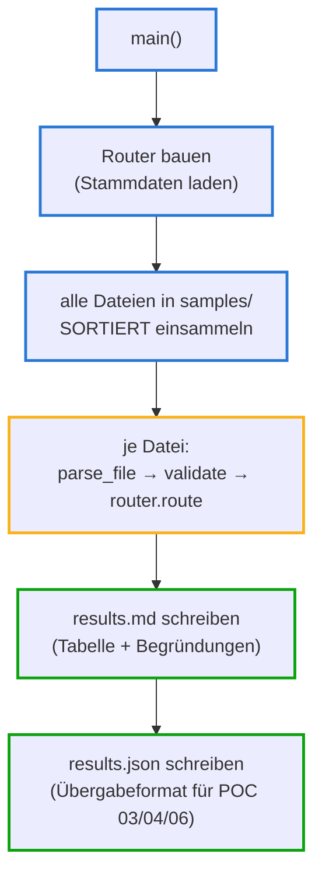

# run.py — der Pipeline-Dirigent (POC 02)

**Zweck in einem Satz:** Schickt alle Belege aus `samples/` nacheinander durch
die drei Schichten ([parsers](atlas-parsers.md) → [validation](atlas-validation.md)
→ [routing](atlas-routing.md)) und schreibt zwei Ergebnisdateien: eine für
Menschen (`results.md`), eine für Maschinen (`results.json`).

**Einordnung in die Kette:** `run.py` enthält selbst **keine Fachlogik** — es
verdrahtet nur. Sein `results.json` ist die Schnittstelle nach außen: Flowable
(POC 03), n8n (POC 04) und das Cockpit (POC 06) konsumieren genau diese Datei.

## Eingaben und Ausgaben

| Was | Details |
|---|---|
| Eingabe | alle `.xml`/`.pdf`-Dateien in `samples/` (die 7 Demo-Belege s1–s7); `masterdata/vendors.json` für den Router |
| Ausgabe | `output/results.md` (Tabelle + Begründungen je Beleg) und `output/results.json` (maschinenlesbar — das Übergabeformat der Kette) |

## Ablauf



Farben unten im Code: **Blau** = Aufbau · **Gelb** = die Verarbeitungsschleife ·
**Grün** = Ausgaben.

## Variablen und Rahmenkriterien

| Element | Wert | Warum so |
|---|---|---|
| `TODAY` | `date(2026, 7, 28)` — fixiert | Reproduzierbarkeit: derselbe Lauf liefert heute und in einem Jahr dieselben Befunde (V07 hängt am Stichtag). Tests nutzen denselben Wert |
| `sorted(…)` | Dateien alphabetisch | Deterministische Reihenfolge — wichtig fürs Dubletten-Register: s1 muss VOR s5 (der Dublette) verarbeitet werden, sonst kippte das Ergebnis |
| `ROUTE_ICON` | 🟢🟡🔴 je Route | Ampel mit Symbol — konsistent zum Status-Farbsystem des Cockpits |

## Prüfungen und Fehlerpfade

- Bewusst **kein** try/except um die Verarbeitung: ein kaputter Beleg stoppt
  den ganzen Lauf. Für die Demo transparent — produktiv ist das die bekannte
  Grenze "Fehlerisolation je Beleg + Dead-Letter-Ablage" (geplanter Ausbau).
- Der `Router` wird **einmal** gebaut und für alle Belege wiederverwendet —
  nur so funktioniert das Dubletten-Register über den Lauf hinweg.

## Der vollständige Code — geführt

<div class="code-row" markdown="1">
<div class="code-col" markdown="1">
<div class="codeblock-label" data-tone="blau">Aufbau · Docstring, Importe, der fixierte Stichtag (Z. 1–19)</div>

```python
"""Pipeline-Lauf: samples/ -> Parse -> Validierung -> Routing -> output/.

Erzeugt output/results.md (menschenlesbar) und output/results.json
(maschinenlesbar — das Format, das ein Workflow-System wie Flowable/n8n
als Trigger-Payload konsumieren würde; siehe POC 03/04).
"""

import json
from datetime import date
from pathlib import Path

from pipeline.models import Route
from pipeline.parsers import parse_file
from pipeline.routing import Router
from pipeline.validation import validate

BASE = Path(__file__).parent
TODAY = date(2026, 7, 28)   # fixiert für Reproduzierbarkeit

ROUTE_ICON = {Route.AUTO_POST: "🟢", Route.REVIEW: "🟡", Route.REJECT: "🔴"}
```
</div>
<aside class="code-notes" markdown="1">

- **`BASE = Path(__file__).parent`:** alle Pfade relativ zur Skript-Datei —
  der Lauf funktioniert aus jedem Arbeitsverzeichnis (die Lektion aus den
  Portabilitäts-Fixes von POC 04).
- **`TODAY` fixiert:** die eine Entscheidung, die diesen Demo-Lauf für immer
  reproduzierbar macht. Produktiv stünde hier natürlich der echte Tag.
- Die Importe zeigen die Architektur in vier Zeilen: Modelle, drei
  Schichten — mehr braucht der Dirigent nicht zu kennen.

</aside>
</div>

<div class="code-row" markdown="1">
<div class="code-col" markdown="1">
<div class="codeblock-label" data-tone="gelb">Die Verarbeitungsschleife · drei Schichten je Beleg (Z. 22–33)</div>

```python
def main() -> None:
    out = BASE / "output"
    out.mkdir(exist_ok=True)
    router = Router(BASE / "masterdata" / "vendors.json")

    decisions = []
    files = sorted(p for p in (BASE / "samples").iterdir()
                   if p.suffix.lower() in (".xml", ".pdf"))
    for path in files:
        inv = parse_file(path)
        findings = validate(inv, TODAY)
        decisions.append((inv, router.route(inv, findings)))
```
</div>
<aside class="code-notes" markdown="1">

- **Ein Router für alle Belege:** das Dubletten-Register (`seen`) lebt im
  Router-Objekt — deshalb erkennt Beleg s5 die schon verarbeitete s1.
- **`sorted(…)` ist hier Fachlogik im Tarnkleid:** ohne deterministische
  Reihenfolge wäre nicht garantiert, welcher der beiden RE-2026-0815-Belege
  als "Original" durchgeht und welcher als Dublette fliegt.
- **Die Kette in drei Zeilen:** `parse_file` → `validate` → `route`. Jede
  Schicht kennt nur ihre Nachbarin über deren Rückgabetyp.
- `decisions` sammelt **Paare** (Invoice, RoutingDecision) — der Report
  unten braucht beides.

</aside>
</div>

<div class="code-row" markdown="1">
<div class="code-col" markdown="1">
<div class="codeblock-label" data-tone="gruen">Report für Menschen · results.md (Z. 34–52)</div>

```python
    lines = ["# Invoice-Pipeline — Ergebnis des Demo-Laufs", "",
             f"{len(decisions)} Belege verarbeitet (Stichtag {TODAY}).", "",
             "| Beleg | Format | Rechnung | Brutto | Route | Risk |",
             "|---|---|---|---|---|---|"]
    for inv, d in decisions:
        lines.append(f"| {d.source_file} | {inv.source_format.value} "
                     f"| {d.invoice_number} | {inv.total_gross} {inv.currency} "
                     f"| {ROUTE_ICON[d.route]} {d.route.value} | {d.risk_score} |")

    lines += ["", "## Begründungen je Beleg", ""]
    for inv, d in decisions:
        lines.append(f"### {d.source_file} — {ROUTE_ICON[d.route]} {d.route.value}")
        for r in d.reasons:
            lines.append(f"- {r}")
        if d.findings:
            lines.append(f"- Validierung: "
                         + "; ".join(f"[{f.severity.value}] {f.code} {f.message}"
                                     for f in d.findings))
        lines.append("")
```
</div>
<aside class="code-notes" markdown="1">

- **Markdown als Zeilen-Liste** aufbauen und am Ende joinen — das übliche
  Muster für generierte Reports (auch `analyze.py` in POC 01 macht es so).
- **ALLE `reasons` werden ausgegeben** — anders als die erste Fassung von
  `belegflut.py`, die nur den ersten Grund zeigte (eine Lektion aus der
  Szenario-Abnahme).
- Der Begründungsteil ist genau das, was das Cockpit später je Beleg im
  Drawer zeigt — gleiche Datenbasis, zwei Darstellungen.

</aside>
</div>

<div class="code-row" markdown="1">
<div class="code-col" markdown="1">
<div class="codeblock-label" data-tone="gruen">Übergabeformat + Konsole · results.json (Z. 53–67)</div>

```python
    (out / "results.md").write_text("\n".join(lines))
    (out / "results.json").write_text(json.dumps(
        [d.model_dump(mode="json") for _, d in decisions],
        indent=2, ensure_ascii=False))

    for inv, d in decisions:
        print(f"{ROUTE_ICON[d.route]} {d.route.value:9s} {d.source_file}")
    print(f"\nReport -> {out/'results.md'}")


if __name__ == "__main__":
    main()
```
</div>
<aside class="code-notes" markdown="1">

- **`model_dump(mode="json")`:** Pydantic serialisiert die Objekte
  JSON-tauglich — `Decimal` wird zu String, `Enum` zu seinem Wert. Deshalb
  steht in `results.json` `"total_gross": "714.00"` (String!), und jeder
  Konsument muss selbst zu Decimal zurückwandeln.
- **`ensure_ascii=False`:** Umlaute bleiben lesbar statt `ü`.
- **`if __name__ == "__main__":`** — Standard-Einstiegspunkt: beim direkten
  Ausführen läuft `main()`, beim Importieren (z. B. aus Tests) nicht.

</aside>
</div>

**Zum Nachschlagen:** Datei `poc/02-invoice-pipeline/run.py` · Konsumenten von
`results.json`: `poc/03-flowable/run_demo.py`, `poc/06-cockpit/app/seed.py`
und `app/server.py`.

## Selbsttest

<details><summary>1. Was würde passieren, wenn die Dateien unsortiert verarbeitet würden?</summary>

Das Dubletten-Ergebnis würde vom Zufall der Dateisystem-Reihenfolge abhängen:
Käme s5 vor s1, wäre s5 das "Original" (AUTO_POST) und s1 die Dublette
(REJECT) — Tabelle, JSON und alle nachgelagerten POCs zeigten andere
Ergebnisse. `sorted()` macht den Lauf deterministisch.
</details>

<details><summary>2. Warum stehen die Beträge in results.json als Strings ("714.00")?</summary>

`model_dump(mode="json")` serialisiert `Decimal` als String, weil JSON nur
Gleitkommazahlen kennt — und ein Geldbetrag als Float wäre genau der
Präzisionsfehler, den `Decimal` vermeiden soll. Konsumenten (z. B. seed.py)
wandeln explizit zurück: `float(d["total_gross"])` für die Prozessvariable.
</details>

<details><summary>3. Ein Beleg wirft beim Parsen eine Exception. Was passiert — und ist das gut?</summary>

Der ganze Lauf bricht ab (kein try/except in der Schleife). Für die Demo ist
das ehrlich-transparent; produktiv wäre es inakzeptabel — ein Giftbeleg darf
nie den Batch stoppen. Genau das ist die geplante Erweiterung "Fehlerisolation je Beleg +
Dead-Letter-Ablage".
</details>
