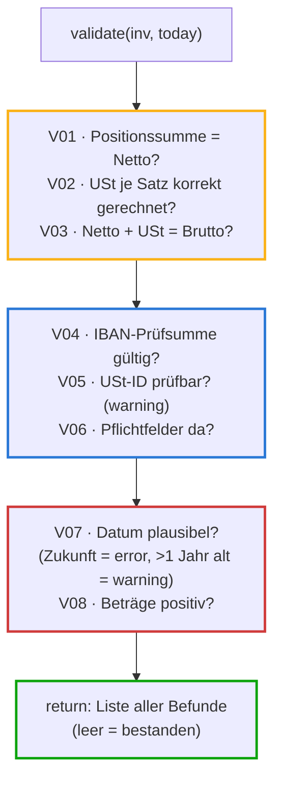

# validation.py — die acht deterministischen Prüfregeln (Schicht 2)

**Zweck in einem Satz:** Prüft jede geparste Rechnung rechnerisch und formal
auf innere Konsistenz — acht Regeln (V01–V08), jede liefert einen Befund mit
Code, Schweregrad (error/warning) und Klartext-Meldung.

**Einordnung in die Kette:** Zweite Schicht, zwischen [parsers.py](atlas-parsers.md)
und [routing.py](atlas-routing.md). Wichtig: `validate()` **entscheidet
nichts** — es sammelt nur Befunde. Was daraus folgt (REVIEW? wie viele
Punkte?), entscheidet allein das Routing. Diese Trennung macht beide Schichten
einzeln testbar.

## Eingaben und Ausgaben

| Was | Details |
|---|---|
| Eingabe | `Invoice`-Objekt (aus dem Parser) + `today` (Stichtag — wird hereingereicht statt `date.today()`, damit Tests und Läufe reproduzierbar sind) |
| Ausgabe | `list[Finding]` — je Befund: Code (V01–V08), Schweregrad, Meldung. Leere Liste = alles bestanden |

## Ablauf



Farben unten im Code: **Gelb** = rechnende Regeln · **Blau** = Aufbau und
formale Prüfungen · **Rot** = Grenzfall-Regeln · **Grün** = Rückgabe.

## Variablen und Rahmenkriterien

| Konstante | Wert | Warum so |
|---|---|---|
| `TOL` | 0,01 € | Rechen-Toleranz: ein Cent Rundungsdifferenz ist legitim (Steuerrundung je Position), mehr ist ein Fehler. Der Mutation-Beweis der Testsuite lief genau über diese Konstante |
| Schweregrade | error / warning | error = rechnerisch falsch oder Pflichtangabe fehlt; warning = auffällig, aber nicht zwingend falsch. Achtung: Warnungen erzwingen im Routing KEIN Review (Design-Lücke T1) |

## Prüfungen und Fehlerpfade

- Die Regeln sind **unabhängig**: jede prüft für sich, keine bricht ab — ein
  Beleg kann mehrere Befunde gleichzeitig tragen.
- V01 prüft nur, **wenn Positionen existieren** (`if inv.lines:`) — der
  PDF-Fallback liefert keine Positionen, dort wäre die Regel sinnlos.
- V05 ist bewusst nur warning: eine nicht validierbare USt-ID kann ein
  Tippfehler des Lieferanten sein; blockieren würde zu viele echte Rechnungen
  aufhalten. Der Stammdaten-Abgleich im Routing fängt den harten Fall.
- **Ehrliche Grenze** (steht im Docstring): Diese Regeln fangen *inkonsistente*
  Extraktionsfehler. Einen in sich stimmigen, aber falschen Wertesatz erkennen
  sie nicht — dagegen helfen nur externe Referenzen (3-Way-Match, Stammdaten)
  und das Confidence-Gate.

## Der vollständige Code — geführt

<div class="code-row" markdown="1">
<div class="code-col" markdown="1">
<div class="codeblock-label" data-tone="blau">Aufbau · Docstring mit der ehrlichen Grenze, Importe, Toleranz, Helfer (Z. 1–31)</div>

```python
"""Deterministische Validierung — Schicht 2 der Pipeline.

Kernprinzip aus der Research-Note: Nach jeder Extraktion (auch der strukturierten)
prüfen deterministische Regeln die innere Konsistenz.

Ehrliche Grenze: Bei LLM-Extraktion fangen diese Regeln INKONSISTENTE
Extraktionsfehler (Werte, die nicht zusammenpassen). Einen in sich kohärenten,
aber falschen Wertesatz erkennen sie nicht — dagegen helfen nur der Abgleich
gegen externe Referenzen (Bestellung/Wareneingang, Stammdaten) sowie das
Confidence-Gate mit Human-in-the-Loop im Routing.
"""

from datetime import date, timedelta
from decimal import Decimal

from stdnum import iban as iban_check
from stdnum.eu import vat as vat_check

from .models import Finding, Invoice, Severity

TOL = Decimal("0.01")


def validate(inv: Invoice, today: date) -> list[Finding]:
    f: list[Finding] = []

    def err(code, msg):
        f.append(Finding(code=code, severity=Severity.ERROR, message=msg))

    def warn(code, msg):
        f.append(Finding(code=code, severity=Severity.WARNING, message=msg))
```
</div>
<aside class="code-notes" markdown="1">

- **`today` als Parameter** statt `date.today()` im Code: die Zeit wird
  hereingereicht — Läufe und Tests sind damit reproduzierbar (Stichtag
  2026-07-28 in `run.py` und `tests/conftest.py`).
- **`python-stdnum`:** Bibliothek für standardisierte Nummern — kennt die
  IBAN-Prüfziffern-Mathematik und die USt-ID-Formate aller EU-Länder.
- **`err`/`warn` sind lokale Hilfsfunktionen** (Closures): sie greifen auf die
  umgebende Liste `f` zu. Spart in jeder Regel eine Zeile und macht den
  Schweregrad im Regel-Code sichtbar.

</aside>
</div>

<div class="code-row" markdown="1">
<div class="code-col" markdown="1">
<div class="codeblock-label" data-tone="gelb">V01–V03 · die rechnenden Regeln (Z. 33–48)</div>

```python
    # V01: Positionssumme == Nettosumme
    if inv.lines:
        line_sum = sum(l.net_amount for l in inv.lines)
        if abs(line_sum - inv.total_net) > TOL:
            err("V01", f"Positionssumme {line_sum} != Nettosumme {inv.total_net}")

    # V02: Steuer je Satz rechnerisch korrekt
    for t in inv.taxes:
        expected = (t.base * t.rate / 100).quantize(TOL)
        if abs(expected - t.amount) > TOL:
            err("V02", f"USt {t.rate}%: erwartet {expected}, ausgewiesen {t.amount}")

    # V03: Netto + Steuer == Brutto
    if abs(inv.total_net + inv.total_tax - inv.total_gross) > TOL:
        err("V03", f"Netto {inv.total_net} + USt {inv.total_tax} "
                   f"!= Brutto {inv.total_gross}")
```
</div>
<aside class="code-notes" markdown="1">

- **`abs(…) > TOL`:** Differenzen werden als Betrag verglichen — egal in
  welche Richtung die Abweichung geht, ab mehr als einem Cent ist es V01/V02/V03.
- **`.quantize(TOL)`:** rundet das Rechenergebnis auf 2 Nachkommastellen —
  die Decimal-Entsprechung von "auf Cent runden".
- **`sum(l.net_amount for l in inv.lines)`:** Generator-Ausdruck — summiert,
  ohne eine Zwischenliste zu bauen.
- Diese drei Regeln fingen im Belegflut-Szenario die manipulierten
  Summen (s2) — und wurden im Mutation-Beweis über `TOL = 1000` absichtlich
  blind gemacht, um zu zeigen, dass die Tests wachen.

</aside>
</div>

<div class="code-row" markdown="1">
<div class="code-col" markdown="1">
<div class="codeblock-label" data-tone="blau">V04–V06 · Prüfnummern und Pflichtfelder (Z. 50–65)</div>

```python
    # V04: IBAN-Prüfsumme
    if inv.seller.iban and not iban_check.is_valid(inv.seller.iban):
        err("V04", f"IBAN ungültig: {inv.seller.iban}")

    # V05: USt-ID (Format + Prüfziffer)
    if inv.seller.vat_id:
        if not vat_check.is_valid(inv.seller.vat_id):
            warn("V05", f"USt-ID nicht validierbar: {inv.seller.vat_id}")
    else:
        warn("V05", "Keine USt-ID des Lieferanten vorhanden")

    # V06: Pflichtfelder
    if inv.invoice_number in ("", "?"):
        err("V06", "Rechnungsnummer fehlt")
    if not inv.seller.iban:
        warn("V06", "Keine IBAN vorhanden — Zahlweg unklar")
```
</div>
<aside class="code-notes" markdown="1">

- **V04 prüft nur, wenn eine IBAN da ist** — das *Fehlen* der IBAN ist ein
  anderer Befund (V06-warning) mit anderer Bedeutung: "ungültig" heißt
  Zahlendreher/Fälschung, "fehlt" heißt Zahlweg ungeklärt.
- **IBAN-Prüfsumme:** die zwei Kontrollziffern der IBAN sind so gerechnet,
  dass Zahlendreher mathematisch auffallen (Modulo-97-Verfahren) — dafür
  braucht es keine Bank, nur Arithmetik.
- **`in ("", "?")`:** der Parser setzt `"?"` als Platzhalter, wenn er keine
  Rechnungsnummer findet — beide Fälle gelten als "fehlt".

</aside>
</div>

<div class="code-row" markdown="1">
<div class="code-col" markdown="1">
<div class="codeblock-label" data-tone="rot">V07–V08 · Grenzfälle: Datum und Vorzeichen (Z. 67–84)</div>

```python
    # V07: Datums-Plausibilität
    if inv.issue_date > today:
        err("V07", f"Rechnungsdatum liegt in der Zukunft: {inv.issue_date}")
    elif inv.issue_date < today - timedelta(days=365):
        warn("V07", f"Rechnungsdatum älter als 1 Jahr: {inv.issue_date}")

    # V08: Beträge müssen positiv sein (Grenzfall aus adversarialem Test)
    if inv.total_gross <= 0 or inv.total_net < 0:
        err("V08", f"Nicht-positiver Betrag: netto {inv.total_net}, "
                   f"brutto {inv.total_gross}")

    return f
```
</div>
<aside class="code-notes" markdown="1">

- **V07 asymmetrisch:** Zukunftsdatum = error (kann nicht stimmen), altes
  Datum = warning (kann Nachzügler sein). Genau diese warning ist der
  T1-Fall: sie allein verhindert keine Dunkelbuchung.
- **V08 entstand test-getrieben** (Stufe 1): erst gab es den adversarialen
  Test mit negativem Brutto (rot), dann diese Regel (grün). Merke die
  Asymmetrie: Brutto `<= 0` (null ist auch verdächtig), Netto nur `< 0`
  (eine 0-Netto-Rechnung mit reiner Steuer wäre denkbar).
- **Grün = Rückgabe:** die gesammelte Befundliste — Entscheidungen trifft
  erst [routing.py](atlas-routing.md).

</aside>
</div>

**Zum Nachschlagen:** Datei `poc/02-invoice-pipeline/pipeline/validation.py` ·
Tests: `tests/test_validation.py` (10 Tests, je Regel isoliert verletzt) und
`tests/test_adversarial.py` (V08-Entstehung).

## Selbsttest

<details><summary>1. Warum bekommt validate() den Stichtag als Parameter, statt selbst auf die Uhr zu schauen?</summary>

Reproduzierbarkeit: Mit `date.today()` würde derselbe Beleg heute bestehen
und in 13 Monaten eine V07-Warnung tragen — Läufe und Tests wären
zeitabhängig. Der hereingereichte Stichtag friert die Zeit ein (run.py:
2026-07-28); Tests nutzen denselben Wert.
</details>

<details><summary>2. Eine Rechnung hat eine ungültige USt-ID und keine IBAN. Welche Befunde entstehen, und wird sie dunkelgebucht?</summary>

Zwei Warnungen (V05 "nicht validierbar", V06 "keine IBAN") — keine errors.
Aber dunkelgebucht wird sie trotzdem nicht: das Routing gibt für die fehlende
IBAN +10 Punkte MIT Grund ("Zahlweg ungeklärt") → REVIEW. Der Fall zeigt die
Arbeitsteilung: validation beschreibt, routing entscheidet.
</details>

<details><summary>3. Warum ist V08 beim Brutto strenger (<= 0) als beim Netto (< 0)?</summary>

Ein Brutto von null oder negativ kann bei einer Eingangsrechnung nie stimmen
(Gutschriften sind eine eigene Belegart, im POC bewusst außen vor). Ein
Netto von exakt 0 wäre theoretisch denkbar (Beleg nur mit Steueranteil) —
darum blockt dort nur das negative Vorzeichen.
</details>
