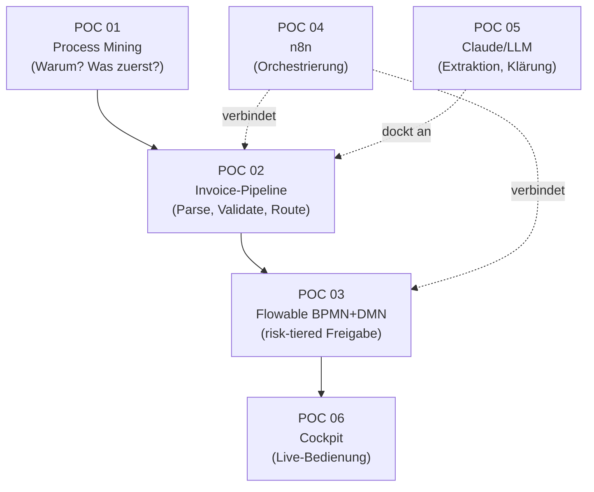
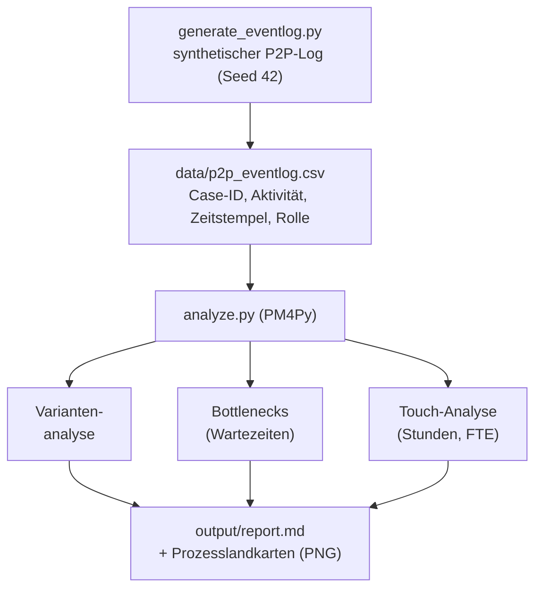
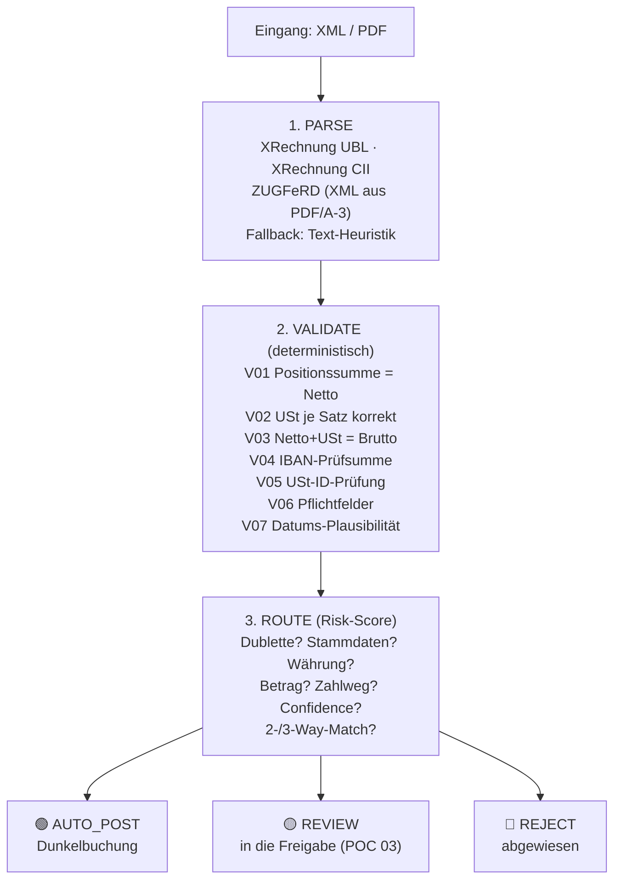
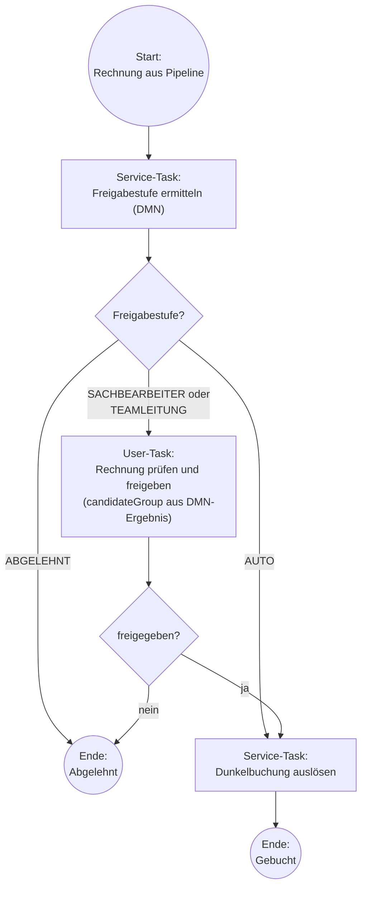
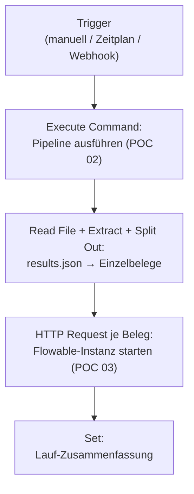
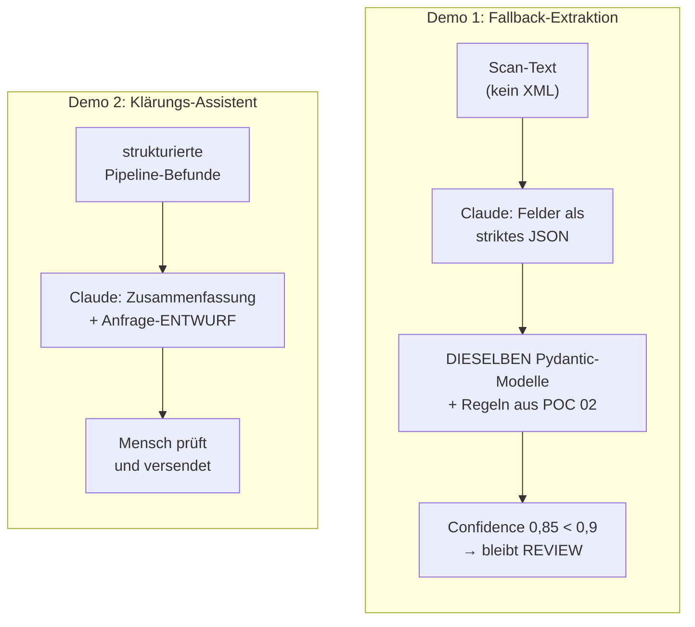
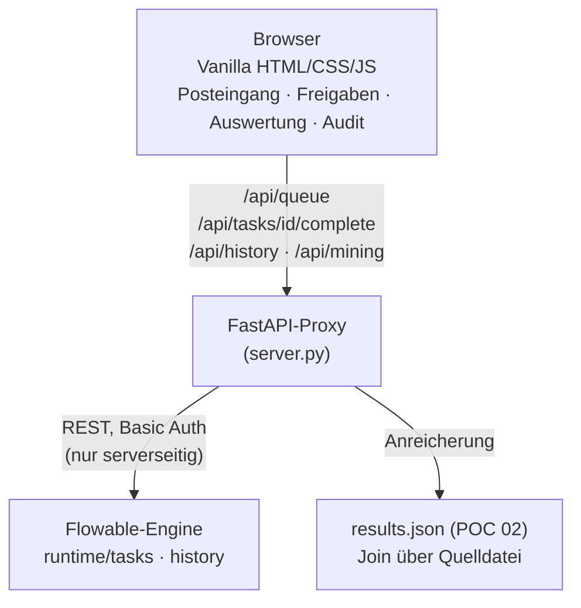

# POC-Walkthrough: verstehen, durchdringen, erklären

Zweck: Du sollst jeden Baustein der Invoice-to-Approval-Kette ("Rechnungseingang
bis Freigabe") **ohne Spickzettel erklären** können. Pro POC (Proof of Concept:
Machbarkeitsnachweis, ein kleines lauffähiges Beispiel): Ablauf als Diagramm,
die Konzepte dahinter, die Zahlen, die man kennen muss, die bewussten Grenzen
(je mit produktivem Schritt) und eine Sprechfassung. Am Ende: Zahlen-Spickzettel,
Selbsttest und ein **Glossar**, das alle Abkürzungen und Fachbegriffe
alphabetisch sammelt. Jeder Begriff wird zusätzlich bei der ersten Nennung kurz
in Klammern erklärt.

Diagramme sind Mermaid (ein Werkzeug, das aus Textbeschreibung Diagramme
zeichnet); GitHub und Obsidian rendern sie direkt.

**Eine Ebene tiefer:** Der [Skript-Atlas](skript-atlas.md) öffnet die
einzelnen Skripte auf Code-Ebene — Eingaben, Verarbeitungsschritte, Variablen,
Prüfungen, Ausgaben je Datei, mit dem vollständigen Code und Erklärnotizen.
Alle Seiten sind über die Leiste oben verbunden; in den Diagrammen sind
Blöcke mit eigener Skript-Seite klickbar.

---

## Das große Bild: eine Kette, ein Prinzip

**Das eine Prinzip, das alles zusammenhält — "risk-tiered autonomy"
(risikogestaffelte Autonomie: je höher das Risiko, desto weniger darf die
Maschine allein):** Das LLM (Large Language Model, großes Sprachmodell wie
Claude) formuliert, extrahiert und schlägt vor. Deterministische Systeme
(deterministisch: gleiche Eingabe führt immer zum gleichen Ergebnis, ohne
Zufall) rechnen und buchen. Der Mensch gibt frei, gestaffelt nach Risiko.
Automatisierung im Finance-Umfeld ist ein Governance-Problem (Governance:
Regeln, Zuständigkeiten und Kontrollen) mit technischer Komponente, nicht
umgekehrt.

**Die Arbeitsteilung (Antwort auf "Warum diese Architektur?"):**

| Verantwortung | Lebt in | Warum dort |
|---|---|---|
| Validierung (rechnerische Prüfung) | Python-Code (Pydantic: Bibliothek, die Daten gegen ein definiertes Schema prüft) | testbar, versionierbar |
| Freigaberegeln | DMN-Tabelle (Decision Model and Notation: Standard für Entscheidungstabellen) | fachlich lesbar, vom Fachbereich pflegbar, ändern ohne Software-Deployment |
| Prozess + menschliche Arbeitsschritte | BPMN-Engine Flowable (BPMN: Business Process Model and Notation, Standard für Prozessmodelle; Engine: die Software, die das Modell ausführt) | Audit-Trail (lückenlose Prüfspur: wer hat wann was entschieden) inklusive; Modell = laufender Prozess |
| Orchestrierung (Steuerung des Zusammenspiels) | n8n (Workflow-Automatisierungswerkzeug) | verbindet nur, entscheidet nichts; austauschbar |
| Unscharfe Ränder (Scans, Formulierungen) | LLM (Claude) | extrahieren/formulieren, nie buchen/freigeben |
| Bedienung | Cockpit (FastAPI: Python-Web-Framework; plus JavaScript ohne Zusatz-Framework) | dünne Schicht über der REST-API der Engine (REST-API: Programmierschnittstelle über das Web-Protokoll HTTP) |

---

## POC 01: Process Mining (PM4Py)

**Frage, die er beantwortet:** "Wo lohnt Automatisierung, und was zuerst?"
Datenbasiert statt anekdotisch.

Process Mining heißt: den realen Prozessablauf aus den digitalen Spuren der
IT-Systeme rekonstruieren, statt Mitarbeiter zu befragen. PM4Py ist die dafür
genutzte Python-Bibliothek. Der untersuchte Prozess ist Purchase-to-Pay (P2P:
von der Bestellung bis zur Bezahlung).

**Konzepte, die Du erklären können musst:**

- **Event-Log** (Ereignisprotokoll): Tabelle aus mindestens Case-ID (Fall-Nummer,
  hier: der Rechnungsvorgang), Aktivität und Zeitstempel. Aus ERP-Systemen
  (Enterprise Resource Planning: das zentrale Unternehmenssystem, z. B. SAP) als
  Datenextrakt gewinnbar, etwa aus Belegfluss-Tabellen.
- **Variante:** ein konkreter Pfad durch den Prozess (die Abfolge der
  Aktivitäten). Wenige Varianten decken meist den Großteil der Fälle ab; die
  teuren stecken in den Abweichungen.
- **Bottleneck** (Engpass): hier gemessen als Wartezeit, bevor eine Aktivität
  startet. Kernbefund: Liegezeiten entstehen **vor manuellen Schritten**, nicht
  im System.
- **Touch** (manueller Eingriff): ein von Menschen ausgeführtes Ereignis.
  Touches × angenommene Bearbeitungszeit = gebundene Stunden, daraus die
  FTE-Schätzung (FTE: Full-Time Equivalent, Vollzeitäquivalent — eine
  rechnerische Vollzeitstelle).
- **Seed 42** (Startwert des Zufallsgenerators): macht die synthetisch erzeugten
  Daten exakt reproduzierbar — jeder Lauf erzeugt denselben Datensatz.

**Zahlen (synthetischer Log, 6 Monate):** 16.518 Events (Einzelereignisse),
2.000 Vorgänge. V1 Happy Path (Idealverlauf ohne Störung) 62 % mit 7,1 Tagen;
V2 Preisabweichung 15 % mit 15,8 Tagen; V3 Mengenabweichung 10 % mit 13,3 Tagen;
V4 ohne Bestellbezug 10 % mit 4,7 Tagen; Dubletten (doppelt eingereichte
Rechnungen) 3 %. Abweichungsfälle laufen **2,1-mal länger** (14,8 vs. 7,1 Tage).
32 % aller Events sind manuelle Touches, zusammen **etwa 0,7 FTE**. Größte
Wartezeiten: vor "Rechnung empfangen" (5,5 Tage) und "Freigabe Fachbereich"
(3,1 Tage). Top-Hebel: Rechnungserfassung (32 Stunden/Monat) und
Preisabweichungsklärung (27 Stunden/Monat).

**Bewusste Grenzen — ehrlich benannt:**

- "Der Faktor 2,1 ist auf dem **Mittelwert** gerechnet (arithmetischer
  Durchschnitt: Summe geteilt durch Anzahl — reagiert stark auf Ausreißer). Auf
  dem **Median** (der mittlere Wert, wenn man alle Fälle der Größe nach sortiert
  — robust gegen Ausreißer) ist der Faktor kleiner, die Aussage bleibt. Im
  Realeinsatz weise ich beides aus."
- "Die FTE-Zahl beruht auf **angenommenen** Bearbeitungszeiten je Touch; real
  durch Task Mining (automatische Aufzeichnung der Bildschirmarbeit) oder
  Interviews kalibrieren."
- "Synthetisch mit Seed heißt: reproduzierbar, keine Datenschutzfragen, und die
  Analyse-Logik überträgt sich eins zu eins auf echte ERP-Extrakte."
- PM4Py ist **AGPL-lizenziert** (Affero General Public License: strenge
  Open-Source-Lizenz — wer die Bibliothek in ein ausgeliefertes Produkt einbaut,
  muss den eigenen Quellcode offenlegen). Für interne Analysen unkritisch, bei
  Einbettung in Produkte Lizenzprüfung; eine kommerzielle Lizenz existiert.

**Sprechfassung:** "Ich habe einen Purchase-to-Pay-Event-Log mit PM4Py
analysiert: Variantenanalyse, Engpässe, manuelle Eingriffe. Der Befund
priorisiert die Automatisierung: Abweichungsfälle laufen doppelt so lange, rund
0,7 Vollzeitstellen hängen in manuellen Schritten, und die zwei größten Hebel
sind Rechnungserfassung und Abweichungsklärung. Genau diese zwei Hebel
adressieren die nächsten POCs."

---

## POC 02: Invoice-Pipeline (Parse, Validate, Route)

**Frage, die er beantwortet:** "Wie kommt eine Rechnung sicher vom Eingang zur
richtigen Entscheidung: dunkel buchen, prüfen lassen oder abweisen?"

Die drei englischen Schichtnamen bedeuten: **Parse** = die Datei maschinell
einlesen und in Felder zerlegen, **Validate** = rechnerisch prüfen,
**Route** = die Entscheidung über den weiteren Weg treffen.

*Die drei Schichten sind klickbar und führen zur jeweiligen Skript-Seite im
[Atlas](skript-atlas.md); der Dirigent dazu: [run.py](atlas-run.md).*

**Konzepte:**

- **XRechnung:** der deutsche Standard für elektronische Rechnungen, basierend
  auf der europäischen Norm **EN 16931** (legt die Pflichtinhalte einer
  E-Rechnung fest). Es gibt ihn in zwei XML-Syntaxen (XML: Extensible Markup
  Language, ein textbasiertes Datenformat mit Auszeichnungs-Tags): **UBL**
  (Universal Business Language) und **CII** (Cross Industry Invoice). Gleiche
  Bedeutung, andere Struktur; die Pipeline liest beide.
- **ZUGFeRD** (Zentraler User Guide des Forums elektronische Rechnung
  Deutschland): hybrides Format — ein PDF/A-3 (PDF-Variante für
  Langzeitarchivierung, die eingebettete Dateien erlaubt) mit XRechnungs-XML im
  Inneren. Menschenlesbar und maschinenlesbar in einer Datei.
- **Validierungsregeln V01 bis V07:** rechnerische Prüfungen wie "Summe der
  Positionen = Nettosumme", "Umsatzsteuer (USt) je Steuersatz korrekt
  gerechnet", **IBAN-Prüfsumme** (IBAN: International Bank Account Number,
  internationale Kontonummer — sie enthält Kontrollziffern, mit denen sich
  Zahlendreher mathematisch erkennen lassen) und Prüfung der USt-ID
  (Umsatzsteuer-Identifikationsnummer). Technisch umgesetzt mit Pydantic und
  python-stdnum (Bibliothek zur Prüfung standardisierter Nummern).
- **Dunkelbuchung:** Buchung komplett ohne menschlichen Eingriff. Nur erlaubt,
  wenn ALLE Prüfungen bestanden sind; jede einzelne Auffälligkeit verhindert sie.
- **2-/3-Way-Match** (Zwei-/Drei-Wege-Abgleich): Rechnung gegen Bestellung
  (2-way) und zusätzlich gegen den Wareneingang, also die bestätigte Lieferung
  (3-way). Die Rechnung mag in sich stimmen; erst der Abgleich beweist, dass
  bestellt und geliefert wurde. Toleranz: der Nettobetrag darf den Bestellwert
  um maximal 2 % übersteigen.

**Die Routing-Logik im Kern (so funktioniert `routing.py`):**
Jeder Befund erzeugt einen Grund und Risikopunkte. **Route = REVIEW, sobald es
überhaupt einen Grund gibt** (der Punktwert entscheidet nicht über die Route; er
priorisiert und steuert später die Eskalation in der DMN-Tabelle). Dubletten
gehen sofort auf REJECT mit dem Maximalwert 100.

| Befund | Punkte |
|---|---|
| Dublette (Lieferant + Rechnungsnummer schon gesehen) | REJECT, 100 |
| Validierungsfehler (V-Codes mit Schweregrad "error") | +40 |
| IBAN weicht von den Stammdaten ab (Betrugsverdacht: Konto könnte umgeleitet sein) | +50 |
| Bestellung gehört zu einem anderen Lieferanten | +40 |
| Neuer Lieferant / Bestellnummer unbekannt | je +30 |
| Netto über Bestellwert + 2 % Toleranz | +30 |
| Wareneingang fehlt (3-Way-Match unvollständig) | +25 |
| Extraktions-Confidence unter 0,9 (Confidence: Vertrauenswert zwischen 0 und 1, wie sicher die Felderkennung war) | +25 |
| Fremdwährung / Brutto über 10.000 € | je +20 |
| Kein Bestellbezug | +15 |
| Keine IBAN im Beleg (Zahlweg ungeklärt) | +10 |
| je Warnung (Schweregrad "warning") | +5 |

**Die 7 Testszenarien:** s1 sauber → AUTO_POST. s2 Summenfehler (CII-Syntax) →
REVIEW. s3 geänderte IBAN im ZUGFeRD → REVIEW (Betrugs-Check, 50 Punkte). s4
konsistent, aber 24.990 € → REVIEW (20 Punkte). s5 Dublette von s1 → REJECT.
s6 Scan ohne XML, Notfall-Extraktion mit Confidence 60 % → REVIEW (75 Punkte).
s7 in sich konsistent, aber über Bestellwert + Toleranz → REVIEW (3-Way-Match,
30 Punkte).

**Bewusste Grenzen — ehrlich benannt:**

- Die Confidence-Werte (0,6 Text-Heuristik / 0,85 LLM) sind **gesetzte
  POC-Konstanten**, bewusst unter der 0,9-Schwelle, damit der Ausweichpfad nie
  dunkelbucht. Produktiv würden sie kalibriert, z. B. aus Logprobs
  (Log-Wahrscheinlichkeiten: wie sicher sich das Modell bei jedem ausgegebenen
  Wortbaustein war) oder Feld-Heuristiken. (ehrlich sagen!)
- Das Dubletten-Register lebt in-memory (nur im Arbeitsspeicher, bei Neustart
  weg); produktiv: ein Idempotenz-Schlüssel (eindeutiger Schlüssel, der die
  doppelte Verarbeitung desselben Belegs technisch verhindert) in einer
  Datenbank.
- Der Match läuft gegen Fixtures (fest hinterlegte Testdaten im JSON-Format;
  JSON: JavaScript Object Notation, ein textbasiertes Datenformat); produktiv
  ersetzt eine ERP-Anbindung die Fixtures, z. B. über OData (Open Data Protocol:
  standardisierte Web-Schnittstelle, verbreitet bei SAP).
- Keine vollständige EN-16931-Validierung; produktiv den KoSIT-Validator
  vorschalten (KoSIT: Koordinierungsstelle für IT-Standards, gibt das offizielle
  Prüfwerkzeug heraus; es prüft mit Schematron, einer Regelsprache für
  XML-Dokumente).
- Die 10.000-€-Grenze steht doppelt im System (Pipeline-Code und DMN-Tabelle):
  **offensiv nutzen** als Governance-Argument — Schwellwerte gehören in die DMN
  als Single Source of Truth (die eine verbindliche Quelle, aus der alle anderen
  lesen).

**Sprechfassung:** "Drei Schichten: Einlesen für XRechnung in beiden Syntaxen
und ZUGFeRD, dann deterministische Validierung von Summen über die
IBAN-Prüfsumme bis zur Datums-Plausibilität, dann risikogestaffeltes Routing mit
Dubletten-Check, Stammdaten-Abgleich inklusive IBAN-Betrugs-Check und
Drei-Wege-Abgleich. Dunkelbuchung nur, wenn alles bestanden ist; jede
Entscheidung trägt Gründe und eine Risikopunktzahl als Prüfspur. Kein
Sprachmodell entscheidet über Buchung oder Zahlung."

**Testfundament (seit 2026-07-30):** Alle
Validierungsregeln (V01–V08) und die komplette Routing-Punktetabelle sind als
automatisierte Tests abgesichert (33 Tests), inklusive Angriffs-Belegen
(XXE-Regression, kaputtes XML) und einem End-to-End-Smoke gegen die laufende
Engine. Jeder Test wurde per Mutation-Beweis geprüft (absichtlich rot gesehen).
Regressionslauf: `uv run pytest` · Details: `docs/test-checkliste.md` ·
Skript-Seiten der Test-Werkzeuge: [belegflut.py](atlas-belegflut.md),
[e2e_smoke.py](atlas-e2e-smoke.md).
Neue Regel V08 (nicht-positive Beträge) entstand test-getrieben aus einem
Angriffsfall; Befund T1 (Nur-Warnung-Belege werden dunkelgebucht) ist als
als offene Design-Entscheidung dokumentiert.

---

## POC 03: Flowable (BPMN + DMN)

**Frage, die er beantwortet:** "Wie wird aus der Routing-Entscheidung ein
auditierbarer Freigabeprozess mit den richtigen Zuständigkeiten?"

Flowable ist eine Open-Source-Prozess-Engine: eine Software, die
BPMN-Prozessmodelle und DMN-Entscheidungstabellen nicht nur zeichnet, sondern
**ausführt**.

Bausteine im Diagramm: **Service-Task** = automatischer Prozessschritt (Software
erledigt ihn), **User-Task** = menschlicher Arbeitsschritt (wartet auf eine
Person), **Gateway** (Raute) = Verzweigung nach Bedingung.

**Die DMN-Tabelle `freigabestufe` (Hit Policy FIRST — Trefferregel "die erste
passende Zeile gewinnt"):**

| # | Bedingung | Stufe |
|---|---|---|
| 1 | route = REJECT | ABGELEHNT |
| 2 | route = AUTO_POST | AUTO (Dunkelbuchung, kein Mensch) |
| 3 | riskScore ≥ 50 | TEAMLEITUNG |
| 4 | brutto > 10.000 | TEAMLEITUNG |
| 5 | sonst | SACHBEARBEITER |

**Konzepte:**

- **BPMN ist ausführbare Dokumentation:** das Modell IST der laufende Prozess;
  Modell und Realität können nicht auseinanderlaufen.
- **DMN-Entscheidungstabelle:** Freigabelogik als fachlich lesbare Tabelle.
  Schwellwert ändern heißt Tabelle ändern, nicht Software neu einspielen
  ("deployen"). **Hit Policy FIRST:** die Regeln werden von oben nach unten
  geprüft, die erste passende gewinnt — die Reihenfolge trägt also Bedeutung;
  deshalb steht REJECT vor AUTO vor den Eskalationsregeln.
- **User-Task + candidateGroups** (Kandidaten-Gruppen): der Arbeitsschritt
  landet in der Warteschlange einer Rolle (Teamleitung oder Sachbearbeitung),
  dynamisch über eine Expression (kleine im Modell hinterlegte Formel) aus dem
  DMN-Ergebnis.
- **Human-in-the-Loop strukturell erzwungen** (Human-in-the-Loop, kurz HITL:
  der Mensch bleibt als Kontrollinstanz in der Schleife): oberhalb der Schwellen
  KANN der Automat nicht buchen. Die Kontrolle liegt in der Prozess-Engine,
  nicht im Wohlverhalten eines Skripts.
- **Historie = Audit-Trail:** jede Aktivität, jede DMN-Ausführung und alle
  Zeitstempel werden protokolliert — die Basis für IKS (Internes Kontrollsystem:
  die unternehmensinternen Kontrollen und Regeln) und Revision (interne
  Prüfinstanz). Ehrliche Grenze im Demo-Stand: Die personenscharfe
  Bearbeiter-Zuordnung am User-Task (Flowable-"assignee") ist noch nicht
  gesetzt; entschieden wird unter der abgeleiteten Rolle (Prozessvariable
  `entschiedenVon`). Echte Attribution kommt mit Login + assignee (geplant).

**Hands-on-Stolpersteine (zeigen echte Beschäftigung):**

- Die REST-Anwendung von Flowable spielt `.dmn`-Dateien nicht über das
  Prozess-Deployment mit ein; die DMN-Tabelle muss separat an die DMN-eigene
  Schnittstelle übergeben werden.
- H2 (leichtgewichtige Java-Datenbank, hier nur im Arbeitsspeicher): Neustart =
  leere Engine. Für die Demo ideal, produktiv PostgreSQL (verbreitete
  Produktions-Datenbank).

**Bewusste Grenzen — ehrlich benannt:**

- 4-Augen-Prinzip (zwei unabhängige Personen müssen prüfen): "Der POC modelliert
  Zuständigkeit; echtes Vier-Augen ist ein zweiter unabhängiger User-Task mit
  Rollentrennung ab Schwelle."
- Wiedervorlage/Klärungsfall: "genau der Anwendungsfall für CMMN (Case
  Management Model and Notation: der Schwester-Standard von BPMN für flexible
  Fallbearbeitung statt festem Ablauf) — bewusster nächster Modellierungsschritt."
 
- GoBD (Grundsätze zur ordnungsmäßigen Führung und Aufbewahrung von Büchern,
  Aufzeichnungen und Unterlagen in elektronischer Form — die deutschen
  Archivierungsvorgaben): "Die Flowable-Historie ist Prozess-Audit, kein
  revisionssicheres Belegarchiv; die 10-Jahres-Ablage ist ein eigener Baustein,
  ein Dokumentenmanagement- oder Archivsystem (DMS)."

**Sprechfassung:** "Die Pipeline liefert Route und Risikopunktzahl, eine
DMN-Tabelle mit der Trefferregel FIRST macht daraus die Freigabestufe:
Ablehnung, Dunkelbuchung, Sachbearbeitung oder Teamleitung ab 50 Punkten oder
über 10.000 Euro. Der menschliche Arbeitsschritt bekommt seine Rolle dynamisch
aus dem DMN-Ergebnis. Das Entscheidende: Die Freigabelogik ist eine fachlich
pflegbare Tabelle statt Code, und die Engine erzwingt den Menschen in der
Schleife strukturell, mit komplettem Audit-Trail."

---

## POC 04: n8n (Orchestrierung)

**Frage, die er beantwortet:** "Was verbindet die Bausteine im Betrieb?"

n8n ist ein Workflow-Automatisierungswerkzeug: Abläufe werden aus Bausteinen
("Nodes") zusammengesteckt, die Daten weiterreichen.

Ein **Trigger** ist der Auslöser des Laufs; ein **Webhook** ist ein
automatischer Aufruf von außen, sobald irgendwo ein Ereignis eintritt (z. B.
"neue Datei im Archivsystem").

**Kernsatz zur Arbeitsteilung:** n8n ist hier bewusst **reine Orchestrierung**,
keine Fachlogik, keine Freigabeentscheidung. Validierung lebt in Python
(testbar), Regeln in der DMN-Tabelle (fachlich pflegbar), menschliche
Arbeitsschritte in der BPMN-Engine (auditierbar).

**Konzepte und Gesprächspunkte:**

- **Lizenz:** n8n ist **fair-code** lizenziert (Quellcode ist offen einsehbar,
  die Nutzung aber eingeschränkt — konkret: Sustainable Use License). Das ist
  **kein** Open Source im Sinne der OSI (Open Source Initiative: die
  Organisation, die definiert, welche Lizenzen als echtes Open Source gelten).
  Interne Nutzung frei; Einbetten in eigene Produkte oder Weiterverkauf nicht.
  SSO (Single Sign-on: zentrale Einmal-Anmeldung im Unternehmen), RBAC
  (Role-Based Access Control: rollenbasierte Zugriffsrechte) und Log-Streaming
  (laufende Übertragung der Protokolle an zentrale Überwachungssysteme) liegen
  in der Enterprise-Lizenz; für IKS-relevante Workflows einkalkulieren.
- **Headless vs. UI** (headless: ohne grafische Oberfläche; UI: User Interface,
  die grafische Oberfläche): derselbe Workflow läuft per CLI (Command Line
  Interface, Kommandozeile) und ist in der Oberfläche visuell editierbar; die
  JSON-Datei ist das Standard-Austauschformat.
- **Der Baustein "Execute Command" setzt Self-Hosting voraus** (Self-Hosting:
  Betrieb auf eigener Infrastruktur statt in der Cloud des Anbieters); in n8n
  Cloud ist er nicht verfügbar. Ein bewusstes Argument für den Eigenbetrieb,
  wenn lokale Skripte automatisiert werden sollen.
- Auslöser im Realbetrieb: Mail-Eingang via IMAP (das Standardprotokoll zum
  Abrufen von E-Mails), Ordner-Überwachung, Webhook vom Dokumentenmanagement;
  der Rest des Workflows bleibt identisch.

**Hands-on-Stolpersteine:** lokal braucht n8n Node.js 22 LTS (Node.js: die
JavaScript-Laufzeitumgebung außerhalb des Browsers; LTS: Long-Term Support,
Version mit Langzeitpflege), inklusive Neu-Kompilieren des
sqlite3-Datenbankmoduls (dokumentiert in run_demo.sh). Außerdem muss auf macOS
die Groß-/Kleinschreibung des Pfads auf die echte Schreibweise gebracht werden,
weil n8ns Dateizugriffs-Schutzvariable den Pfad buchstabengetreu vergleicht.

**Sprechfassung:** "n8n klammert die Kette: Pipeline ausführen, Ergebnis in
Einzelbelege zerlegen, je Beleg über die REST-Schnittstelle eine
Flowable-Instanz starten. Bewusst reine Orchestrierung ohne Fachlogik. Wichtig
im Enterprise-Kontext: die fair-code-Lizenz und Enterprise-Funktionen wie
zentrale Anmeldung und Rollenrechte einkalkulieren."

---

## POC 05: Claude als LLM-Baustein

**Frage, die er beantwortet:** "Wo darf ein Sprachmodell in einen
Finance-Prozess, und wo nicht?"

**Konzepte:**

- **Grounded generation** (geerdete Generierung): Claude bekommt die
  strukturierten Befunde als Grundlage und darf keine eigenen Zahlen erfinden.
  Die Zahlen kommen aus dem System, das Sprachmodell formuliert nur.
- **Doppelte Absicherung der Extraktion:** der LLM-Output läuft durch dasselbe
  Pydantic-Schema und dieselben deterministischen Regeln wie jeder andere Beleg
  (Summen, IBAN-Prüfsumme, USt-Rechnung). Halluzinierte Beträge (Halluzination:
  eine vom Modell erfundene, plausibel klingende, aber falsche Angabe) fallen
  dort auf.
- **Confidence-Schwelle:** die LLM-Extraktion bekommt den Vertrauenswert 0,85
  zugewiesen, liegt damit unter der 0,9-Schwelle — also nie Dunkelbuchung über
  den Ausweichpfad.
- Merksatz: **LLM-Aufgaben:** extrahieren, zusammenfassen, formulieren,
  vorschlagen. **Nie:** buchen, freigeben, Zahlen berechnen, Schwellwerte
  entscheiden. Die Kontrolle liegt in Code und Prozess-Engine, nicht im Prompt
  (der Eingabetext bzw. die Anweisung an das Modell).
- Technik im POC: Claude läuft headless über den Kommandozeilen-Aufruf
  `claude -p`, gestartet als Unterprozess aus Python. Produktiv: die Claude API
  (Programmierschnittstelle des Herstellers) mit Structured Outputs (erzwungen
  schema-konforme, maschinenlesbare Antworten) bzw. das Agent SDK (Software
  Development Kit: Entwicklungsbaukasten für Agenten), Bildverständnis (Vision)
  für Beleg-Scans, MCP (Model Context Protocol: offener Standard, über den
  Modelle kontrolliert auf Werkzeuge und Daten zugreifen) für ERP-Abfragen —
  weiterhin mit Freigabe-Schranken und Mensch in der Schleife. Datenschutz:
  DSGVO (Datenschutz-Grundverordnung) beachten, also EU-Hosting oder lokales
  Modell prüfen, bevor echte Belegdaten an eine Cloud-Schnittstelle gehen.

**Warum das der teuerste Hebel ist:** POC 01 zeigt die Abweichungsklärung mit
durchschnittlich 25 Minuten pro Fall als zweitgrößten manuellen Block; Demo 2
setzt genau dort an.

**Sprechfassung:** "Zwei Demos: Erstens ersetzt Claude die Text-Heuristik für
Scans ohne XML, aber der Output läuft durch dieselben deterministischen Regeln
wie jeder Beleg, und der Vertrauenswert bleibt unter der Dunkelbuchungs-Schwelle.
Zweitens entwirft Claude aus den strukturierten Befunden die Lieferanten-Anfrage
für die Abweichungsklärung, den teuersten manuellen Schritt aus dem Mining.
Beides nach demselben Prinzip: Das Sprachmodell sitzt zwischen deterministischen
Schichten, nie an deren Stelle."

---

## POC 06: Freigabe-Cockpit (Stufe A + B)

**Frage, die er beantwortet:** "Wie sieht das für die Sachbearbeitung aus?"

- **Stufe A:** statisch generiertes Dashboard (Übersichtsseite) aus den
  gespeicherten POC-Ergebnissen, offline vorführbar.
- **Stufe B:** echte Bedienung. Freigeben/Ablehnen aus der Oberfläche, der
  Arbeitsschritt verschwindet live aus der Warteschlange, der Audit-Trail
  wächst sichtbar.

**Architektur-Entscheidungen, die Du begründen können musst:**

- **Warum ein Proxy** (Zwischenserver, der Anfragen entgegennimmt und
  kontrolliert weiterreicht)? Er hält die Zugangsdaten der Engine aus dem
  Browser heraus (im POC nutzt die Engine Basic Auth: einfache Anmeldung mit
  Nutzername und Passwort bei jeder Anfrage), liefert die Oberfläche vom selben
  Server aus wie die Daten ("same-origin" — dadurch greift CORS gar nicht erst;
  CORS: Cross-Origin Resource Sharing, die Browser-Schutzregel für Zugriffe auf
  fremde Server) und reichert die Arbeitsschritte um die Beleg-Daten an.
  Produktiv wäre der Proxy der Platz für zentrale Anmeldung (SSO),
  Rollenprüfung und Rate-Limits (Mengenbegrenzung von Anfragen).
- **Join über die Quelldatei, nicht die Belegnummer** (Join: das Zusammenführen
  zweier Datenquellen über einen gemeinsamen Schlüssel): die Belegnummer ist
  wegen des Dubletten-Falls (s5 = Kopie von s1) nicht eindeutig, der Dateiname
  schon.
- **Kommentar-Pflicht bei Ablehnung**, im Browser UND am Server geprüft: der
  Kommentar ist Teil des Audit-Trails (Governance im Kleinen).
- **Das Seed-Skript lässt die Arbeitsschritte offen:** anders als die
  POC-03-Demo entscheidet nichts automatisch; die 5 Prüf-Fälle warten in der
  Warteschlange auf echte Bedienung. (Hinweis: "Seed" heißt hier "die Demo
  bestücken" — nicht zu verwechseln mit dem Zufalls-Seed aus POC 01.)

**Ehrliche Einordnung:** "Das Cockpit bedient die
Flowable-Warteschlange live. Rollen sind im Demo-Umfang abgeleitet statt
authentifiziert (die Anwendung schließt aus der DMN-Stufe auf die Rolle, statt
den Benutzer per Anmeldung zu prüfen); zentrale Anmeldung wäre der nächste
Baustein."

---

## Zahlen-Spickzettel

| Zahl | Bedeutung |
|---|---|
| 16.518 / 2.000 | Events (Einzelereignisse) / Rechnungsvorgänge im Mining-Log (6 Monate, Zufalls-Seed 42) |
| 2,1× (14,8 vs. 7,1 Tage) | Abweichungsfälle vs. Happy Path (Idealverlauf), auf dem Mittelwert gerechnet |
| 62 % | Anteil Happy Path (Variante V1) |
| 32 % / ~0,7 FTE | Anteil manueller Eingriffe / gebundene Vollzeitstellen-Äquivalente |
| 32 + 27 Stunden/Monat | größte manuelle Blöcke: Rechnungserfassung + Preisabweichungsklärung |
| 25 Minuten | durchschnittliche Abweichungsklärung je Fall (Ansatzpunkt für POC 05, Demo 2) |
| 7 Belege: 1× AUTO, 5× REVIEW, 1× REJECT | Pipeline-Testszenarien s1 bis s7 |
| 10.000 € | Dunkelbuchungs-/Eskalationsgrenze (steht bewusst doppelt: Code + DMN-Tabelle) |
| Risikopunkte ≥ 50 | DMN-Eskalation zur Teamleitung |
| 0,9 / 0,85 / 0,6 | Vertrauensschwelle für Dunkelbuchung / LLM-Extraktion / Text-Heuristik |
| 2 % | Toleranz beim Drei-Wege-Abgleich (Netto vs. Bestellwert) |
| 7.2.0 | Version der Flowable-Engine |

---

## Selbsttest (erst antworten, dann aufklappen)

1. Warum landet s4 (24.990 €, in sich fehlerfrei) bei der Teamleitung?

Zwei Stufen: Die Pipeline routet auf REVIEW, weil der Bruttobetrag über der
10.000-€-Dunkelbuchungsgrenze liegt (+20 Risikopunkte). In der DMN-Tabelle zieht
Regel 4 (brutto > 10.000 → TEAMLEITUNG), obwohl die Punktzahl nur 20 ist.

2. Was ist der Unterschied zwischen Route und Risk-Score?

Die Route (AUTO_POST/REVIEW/REJECT) entscheidet, OB ein Mensch draufschaut;
schon ein einziger Grund erzwingt REVIEW. Die Risikopunktzahl misst, wie
kritisch der Fall ist, und steuert die Eskalationsstufe in der DMN-Tabelle
(ab 50 Punkten → Teamleitung).

3. Warum Hit Policy FIRST in der DMN, und warum steht REJECT oben?

FIRST heißt: die erste passende Regel gewinnt, die Reihenfolge trägt also
Bedeutung. REJECT und AUTO_POST müssen vor den Eskalationsregeln stehen, sonst
würde z. B. eine Dublette mit 100 Punkten fälschlich als Teamleitungs-Aufgabe
landen.

4. Wie verhindert die Kette, dass ein halluzinierter Betrag gebucht wird?

Dreifach: (1) Das LLM-Extrakt läuft durch dieselben deterministischen Regeln
(Summen, IBAN-Prüfsumme, USt-Rechnung), (2) der Vertrauenswert 0,85 liegt unter
der 0,9-Schwelle, also nie AUTO_POST, (3) die Prozess-Engine erzwingt oberhalb
der Schwellen einen menschlichen Arbeitsschritt.

5. Warum ist der 3-Way-Match nötig, wenn die Rechnung rechnerisch stimmt?

Interne Konsistenz beweist nicht, dass bestellt und geliefert wurde. Erst der
Abgleich gegen Bestellung (Preis, Lieferant) und Wareneingang schützt vor
gefälschten Rechnungen und Überfakturierung (mehr berechnen als bestellt). s7
demonstriert das: in sich fehlerfrei, aber über Bestellwert + 2 % → REVIEW.

6. XRechnung UBL vs. CII vs. ZUGFeRD in einem Satz?

UBL und CII sind zwei XML-Syntaxen für dieselben Inhalte nach der europäischen
Rechnungsnorm EN 16931; ZUGFeRD ist ein PDF/A-3 mit demselben eingebetteten
XML, also menschen- und maschinenlesbar zugleich.

7. Warum entscheidet n8n nichts?

Bewusste Arbeitsteilung: Orchestrierung ist austauschbar und schwer testbar,
also gehört Fachlogik nicht hinein. Validierung in Python (testbar), Regeln in
der DMN-Tabelle (fachlich pflegbar), menschliche Arbeitsschritte in der
BPMN-Engine (auditierbar). n8n verbindet nur.

8. Was antwortest Du auf "Ihr Cockpit hat ja gar kein Login"?

"Bewusste Grenze des Demo-Umfangs: Rollen sind abgeleitet statt authentifiziert.
Der Proxy ist genau der Platz, an dem produktiv zentrale Anmeldung (SSO/OAuth)
und Rollenprüfung sitzen; die Zugangsdaten der Engine sind heute schon
serverseitig gekapselt."

9. Warum sind Confidence-Werte im POC Konstanten, und ist das ein Problem?

Ehrlich benennen: gesetzte Werte (0,6 Text-Heuristik, 0,85 LLM), bewusst unter
der 0,9-Schwelle, damit der Ausweichpfad nie dunkelbucht. Produktiv werden sie
kalibriert, z. B. aus den Wahrscheinlichkeitswerten des Modells. Kein Problem,
solange man es nicht als Messung verkauft.

10. Wieso steht die 10.000-€-Grenze doppelt im System, und warum ist das eine gute Antwort?

Sie steht im Pipeline-Code UND in der DMN-Tabelle. Offensiv nutzen: "Genau
deshalb gehören Schwellwerte in die DMN als die eine verbindliche Quelle
(Single Source of Truth), aus der die Pipeline liest. Das ist das
Governance-Argument für DMN aus meinem eigenen POC."

---

## Glossar (alphabetisch)

| Begriff | Bedeutung |
|---|---|
| AGPL | Affero General Public License: strenge Open-Source-Lizenz; wer die Software in ausgelieferte Produkte einbaut, muss eigenen Quellcode offenlegen |
| API | Application Programming Interface: Programmierschnittstelle, über die Programme miteinander sprechen |
| Audit-Trail | lückenlose Prüfspur: wer hat wann was entschieden und getan |
| Basic Auth | einfache Anmeldung mit Nutzername/Passwort bei jeder Anfrage |
| BPMN | Business Process Model and Notation: Standard, um Prozesse zu modellieren — und (mit einer Engine) direkt auszuführen |
| Case-ID | Fall-Nummer im Event-Log; hier: ein Rechnungsvorgang |
| CII | Cross Industry Invoice: eine der zwei XML-Syntaxen der XRechnung |
| CLI | Command Line Interface: Bedienung über die Kommandozeile statt grafischer Oberfläche |
| CMMN | Case Management Model and Notation: Standard für flexible Fallbearbeitung (Schwester von BPMN) |
| Confidence | Vertrauenswert zwischen 0 und 1: wie sicher die automatische Felderkennung war |
| CORS | Cross-Origin Resource Sharing: Browser-Schutzregel für Datenzugriffe auf fremde Server |
| Deployment | das Einspielen von Software oder Modellen auf ein laufendes System |
| Deterministisch | gleiche Eingabe führt immer zum gleichen Ergebnis, ohne Zufall |
| DMN | Decision Model and Notation: Standard für Entscheidungstabellen, die eine Engine direkt ausführt |
| DMS | Dokumentenmanagementsystem: Software zur Ablage und revisionssicheren Archivierung von Dokumenten |
| DSGVO | Datenschutz-Grundverordnung: das europäische Datenschutzrecht |
| Dunkelbuchung | Buchung komplett ohne menschlichen Eingriff |
| EN 16931 | europäische Norm, die die Pflichtinhalte elektronischer Rechnungen festlegt |
| Engine | Software, die Modelle (BPMN/DMN) nicht nur speichert, sondern ausführt |
| ERP | Enterprise Resource Planning: zentrales Unternehmenssystem für Finanzen, Einkauf, Logistik (z. B. SAP) |
| Event-Log | Ereignisprotokoll: Tabelle aus Fall, Aktivität und Zeitstempel; Rohstoff des Process Mining |
| Fair-code | Quellcode offen einsehbar, Nutzung aber eingeschränkt; kein Open Source im OSI-Sinn |
| FastAPI | Python-Framework zum Bau von Web-Schnittstellen |
| Fixtures | fest hinterlegte Testdaten, die im Test/POC ein echtes System ersetzen |
| FTE | Full-Time Equivalent, Vollzeitäquivalent: rechnerische Vollzeitstelle |
| Gateway | Verzweigung im BPMN-Prozess (Raute): der Weg hängt von einer Bedingung ab |
| GoBD | deutsche Grundsätze zur ordnungsmäßigen Führung und Aufbewahrung von Büchern und Unterlagen in elektronischer Form |
| Governance | Regeln, Zuständigkeiten und Kontrollen, unter denen Technik betrieben wird |
| Grounded generation | geerdete Generierung: das Sprachmodell formuliert nur aus vorgegebenen Daten, erfindet keine eigenen |
| H2 | leichtgewichtige Java-Datenbank; im POC nur im Arbeitsspeicher betrieben |
| Halluzination | vom Sprachmodell erfundene, plausibel klingende, aber falsche Angabe |
| Happy Path | der Idealverlauf eines Prozesses ohne Störungen oder Abweichungen |
| Headless | Betrieb ohne grafische Oberfläche, gesteuert über Kommandozeile oder Schnittstellen |
| Hit Policy FIRST | Trefferregel einer DMN-Tabelle: die erste passende Zeile gewinnt, Reihenfolge trägt Bedeutung |
| HITL | Human-in-the-Loop: der Mensch bleibt als Kontrollinstanz in der Schleife |
| IBAN | International Bank Account Number: internationale Kontonummer mit eingebauten Kontrollziffern (Prüfsumme) |
| IDP | Intelligent Document Processing: KI-gestützte Dokumentenerfassung |
| IKS | Internes Kontrollsystem: die unternehmensinternen Kontrollen und Regeln, u. a. für die Rechnungslegung |
| IMAP | Standardprotokoll zum Abrufen von E-Mails |
| In-Memory | nur im Arbeitsspeicher gehalten; bei Neustart verloren |
| Idempotenz-Schlüssel | eindeutiger Schlüssel, der die doppelte Verarbeitung desselben Vorgangs technisch verhindert |
| Join | Zusammenführen zweier Datenquellen über einen gemeinsamen Schlüssel |
| JSON | JavaScript Object Notation: textbasiertes Datenformat für strukturierte Daten |
| KoSIT | Koordinierungsstelle für IT-Standards: gibt u. a. den offiziellen XRechnungs-Validator heraus |
| LLM | Large Language Model: großes Sprachmodell (z. B. Claude) |
| Logprobs | Log-Wahrscheinlichkeiten: wie sicher sich das Modell bei jedem ausgegebenen Wortbaustein war |
| LTS | Long-Term Support: Software-Version mit garantierter Langzeitpflege |
| MCP | Model Context Protocol: offener Standard, über den Sprachmodelle kontrolliert Werkzeuge und Daten ansprechen |
| Median | der mittlere Wert, wenn man alle Fälle der Größe nach sortiert; robust gegen Ausreißer |
| Mermaid | Werkzeug, das aus Textbeschreibungen Diagramme zeichnet |
| Mittelwert | arithmetischer Durchschnitt (Summe geteilt durch Anzahl); reagiert empfindlich auf Ausreißer |
| Node.js | JavaScript-Laufzeitumgebung außerhalb des Browsers; Basis von n8n |
| OData | Open Data Protocol: standardisierte Web-Schnittstelle für Datenzugriff, verbreitet bei SAP |
| Orchestrierung | Steuerung des Zusammenspiels mehrerer Systeme/Schritte |
| OSI | Open Source Initiative: definiert, welche Lizenzen als echtes Open Source gelten |
| P2P | Purchase-to-Pay: der Prozess von der Bestellung bis zur Bezahlung |
| Parse / Parsing | eine Datei maschinell einlesen und in ihre Bestandteile/Felder zerlegen |
| PDF/A-3 | PDF-Variante für Langzeitarchivierung, die eingebettete Dateien (z. B. XML) erlaubt |
| PM4Py | Python-Bibliothek für Process Mining |
| POC | Proof of Concept: Machbarkeitsnachweis, ein kleines lauffähiges Beispiel |
| PostgreSQL | verbreitete Produktions-Datenbank (Open Source) |
| Process Mining | Prozessanalyse aus den digitalen Spuren der IT-Systeme statt aus Befragungen |
| Prompt | Eingabetext bzw. Anweisung an ein Sprachmodell |
| Proxy | Zwischenserver, der Anfragen entgegennimmt, kontrolliert und weiterreicht |
| Prüfsumme | eingebaute Kontrollziffern (z. B. in der IBAN), mit denen sich Tippfehler mathematisch erkennen lassen |
| Pydantic | Python-Bibliothek, die Daten gegen ein definiertes Schema prüft |
| Queue | Warteschlange (hier: offene Arbeitsschritte einer Rolle) |
| Rate-Limit | Mengenbegrenzung von Anfragen pro Zeiteinheit |
| RBAC | Role-Based Access Control: rollenbasierte Zugriffsrechte |
| Regex | regulärer Ausdruck: formales Suchmuster für Text |
| REST(-API) | Programmierschnittstelle über das Web-Protokoll HTTP |
| Risk-Score | Risikopunktzahl (hier 0 bis 100), die Befunde aufsummiert und die Eskalation steuert |
| Same-Origin | Seite und Daten kommen vom selben Server; dadurch greifen CORS-Beschränkungen nicht |
| Schematron | Regelsprache zur inhaltlichen Prüfung von XML-Dokumenten |
| SDK | Software Development Kit: Entwicklungsbaukasten eines Herstellers |
| Seed | Startwert eines Zufallsgenerators; macht Zufallsdaten reproduzierbar (POC 06: Name des Skripts, das die Demo bestückt) |
| Self-Hosting | Betrieb von Software auf eigener Infrastruktur statt in der Anbieter-Cloud |
| Service-Task | automatischer Prozessschritt in BPMN (Software erledigt ihn) |
| Single Source of Truth | die eine verbindliche Quelle, aus der alle anderen Systeme lesen |
| sqlite3 | kleine, in Programme eingebettete Datenbank |
| SSO | Single Sign-on: zentrale Einmal-Anmeldung im Unternehmen |
| Structured Outputs | erzwungen schema-konforme, maschinenlesbare Antworten eines Sprachmodells |
| Task Mining | automatische Aufzeichnung der Arbeit am Bildschirm zur Kalibrierung von Bearbeitungszeiten |
| Touch | manueller Eingriff: ein von Menschen ausgeführtes Prozessereignis |
| Trigger | Auslöser eines Workflow-Laufs |
| UBL | Universal Business Language: eine der zwei XML-Syntaxen der XRechnung |
| UI | User Interface: grafische Benutzeroberfläche |
| User-Task | menschlicher Arbeitsschritt in BPMN; wartet auf eine Person |
| USt / USt-ID | Umsatzsteuer / Umsatzsteuer-Identifikationsnummer |
| Validierung | rechnerische bzw. regelbasierte Prüfung von Daten |
| Variante | ein konkreter Pfad durch den Prozess (Abfolge der Aktivitäten) |
| Webhook | automatischer HTTP-Aufruf von außen, sobald ein Ereignis eintritt |
| XML | Extensible Markup Language: textbasiertes Datenformat mit Auszeichnungs-Tags |
| XRechnung | deutscher Standard für elektronische Rechnungen auf Basis der EN 16931 |
| ZUGFeRD | Zentraler User Guide des Forums elektronische Rechnung Deutschland: hybrides Rechnungsformat (PDF + eingebettetes XML) |
| Ø | Zeichen für "Durchschnitt" (Mittelwert) |

---
