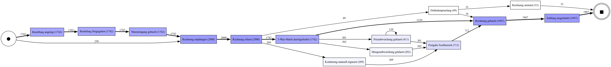
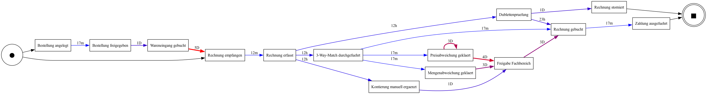

# P2P Process-Mining-Quick-Scan — Ergebnisbericht

Datenbasis: **16518 Events, 2000 Rechnungsvorgänge**, 2026-01-05 bis 2026-07-16 (synthetischer Log, Seed 42).

## 1. Prozessvarianten

| Variante | Fälle | Anteil | Ø Durchlaufzeit | Median |
|---|---|---|---|---|
| V1_happy_path | 1239 | 62% | 7.1 d | 7.1 d |
| V2_preisabweichung | 301 | 15% | 15.8 d | 15.6 d |
| V4_ohne_bestellbezug | 209 | 10% | 4.7 d | 4.9 d |
| V3_mengenabweichung | 202 | 10% | 13.3 d | 13.4 d |
| V5_dublette_storno | 33 | 2% | 38.2 h | 36.0 h |
| V5_dublette_ok | 16 | 1% | 34.5 h | 33.3 h |

**Befund:** Abweichungsfälle (V2/V3) laufen im Schnitt **2.1x länger** als der Happy Path (14.8 d vs. 7.1 d); auf dem Median gerechnet 2.0x (14.5 d vs. 7.1 d) — beide Sichten ausweisen, der Mittelwert reagiert auf Ausreißer.

## 2. Bottlenecks (Wartezeit bis zur Aktivität)

| Aktivität | Ø Wartezeit | Median | Vorkommen |
|---|---|---|---|
| Rechnung empfangen | 5.5 d | 5.4 d | 1742 |
| Freigabe Fachbereich | 3.1 d | 2.5 d | 712 |
| Rechnung gebucht | 26.6 h | 0.4 h | 1967 |
| Wareneingang gebucht | 25.6 h | 25.5 h | 1742 |
| Rechnung storniert | 25.2 h | 27.6 h | 33 |
| Preisabweichung geklaert | 25.1 h | 0.4 h | 411 |
| Kontierung manuell ergaenzt | 12.7 h | 12.9 h | 209 |
| 3-Way-Match durchgefuehrt | 12.4 h | 12.5 h | 1742 |

**Befund:** Die größten Liegezeiten entstehen vor manuellen Klärungs- und Freigabeschritten — nicht in der Systemverarbeitung.

## 3. Manuelle Touches

5358 manuelle Bearbeitungsschritte (32% aller Events); geschätzte Bindung: **~0.7 FTE** (Annahmen: Handling-Minuten je Touch, 140 prod. h/Monat).

| Aktivität | Touches | Min/Touch (Annahme) | Std/Monat |
|---|---|---|---|
| Rechnung erfasst | 2000 | 6 | 32 |
| Bestellung freigegeben | 1742 | 3 | 14 |
| Freigabe Fachbereich | 712 | 5 | 9 |
| Preisabweichung geklaert | 411 | 25 | 27 |
| Kontierung manuell ergaenzt | 209 | 10 | 6 |
| Mengenabweichung geklaert | 202 | 20 | 11 |
| Dublettenpruefung | 49 | 12 | 2 |
| Rechnung storniert | 33 | 8 | 1 |

## 4. Automatisierungs-Heatmap

Score = Touches x Handling-Zeit (Std/Monat), d.h. gebundene Kapazität — gerankt nach Automatisierungspotenzial:

| Rang | Aktivität | Std/Monat | Empfohlener Hebel |
|---|---|---|---|
| 1 | Rechnung erfasst | 32 | IDP/E-Rechnung: XRechnung/ZUGFeRD strukturiert parsen, Rest via Extraktion+Validierung |
| 2 | Preisabweichung geklaert | 27 | Agent+HITL: Toleranzregeln automatisch, Rest LLM-Vorklärung mit Beleg-Kontext |
| 3 | Bestellung freigegeben | 14 | Workflow (DPA): Schwellwert-basierte Auto-Freigabe via DMN-Regeln |
| 4 | Mengenabweichung geklaert | 11 | Regeln+Workflow: Toleranzband, automatische Nachforderung an Lieferant |
| 5 | Freigabe Fachbereich | 9 | Workflow (DPA): risk-tiered — Kleinbetrag/bekannter Kreditor automatisch |
| 6 | Kontierung manuell ergaenzt | 6 | ML/LLM-Kontierungsvorschlag aus Historie (Confidence-Gate) |
| 7 | Dublettenpruefung | 2 | Deterministisch: Fuzzy-Matching (Betrag+Datum+Vendor+Referenz) |
| 8 | Rechnung storniert | 1 | Folgeprozess der Dublettenpruefung — entfällt größtenteils mit ihr |

**Lesart für die Priorisierung (2x2 Aufwand x Nutzen):** Dublettenpruefung und Freigaben sind Quick Wins (deterministisch, geringer Aufwand); Rechnungserfassung ist der größte Hebel, braucht aber IDP/E-Rechnungs-Pipeline; Abweichungsklärung ist wertvoll, aber Agent+HITL-Terrain (höchste Komplexität).

## 5. Prozesslandkarten

